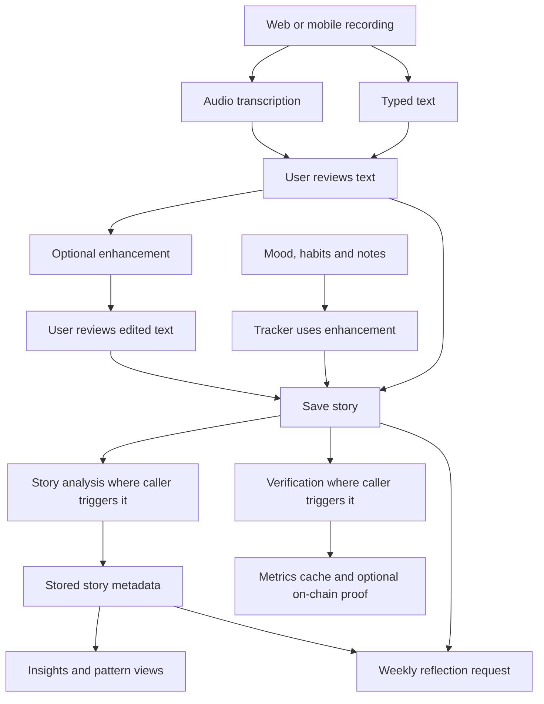

# iStory AI workflows: walkthrough before evaluation

Status: source review and evaluation planning only. No application changes or evaluation runs are included.

Implementation follow-up, 2026-10-28: this document preserves the original source review. The candidate now has a shared production LangGraph workflow, durable analysis jobs, owner-scoped status, strict task schemas and parked CRE routes. References below to their absence or to active CRE describe the historical baseline. Read [the current runtime walkthrough and operations](AI_RUNTIME_AND_OPERATIONS.md), [the executable evaluation README](../evals/README.md) and [implementation evidence](IMPLEMENTATION_STATUS_2026-10-28.md) for the candidate. The original production audit remains historical evidence.

Reviewed on 2026-10-26 against local `master`, commit `d0cb70220b3ab1b2c48261578205758d0d1db51e`. Existing uncommitted workspace changes were present. This describes the checked-out source, not independently verified production behavior.

Read this document first, then [the evaluation criteria and implementation guide](AI_AGENT_EVALUATION_IMPLEMENTATION_GUIDE.md). The second document turns these workflows into datasets, evaluators, LangGraph adapters, and LangSmith experiments.

## 1. What the platform's AI agent actually is

iStory currently uses several task-specific AI calls connected by application code. It does not currently have a LangGraph agent, a conversational planning loop, a vector retrieval pipeline, or a shared agent memory service in the reviewed product paths. Neither `@langchain/langgraph` nor `langsmith` is declared in the root or mobile package manifest.

The important distinction for evaluation is that the platform produces several different kinds of output:

| Workflow | Trigger | Provider in source | Result |
| --- | --- | --- | --- |
| Transcription | Record screen submits audio | ElevenLabs `scribe_v1` | Transcript for the user to review |
| Enhancement | User enhances writing | Gemini `gemini-2.5-flash` | Edited text |
| Tracker journal | User generates an entry from mood, habits, and notes | Reuses enhancement endpoint | Generated text, then a saved story |
| Story analysis | Web recording save, journal save, or manual insight request | Gemini `gemini-2.5-flash` | Structured metadata and insight; advice generated but response depends on plan |
| Weekly reflection | User requests a reflection on web profile | Gemini `gemini-2.5-flash` | Cross-entry narrative and summary labels |
| Verification | Journal background trigger or manual verification | CRE-configured Gemini model, or direct `gemini-2.0-flash` fallback | Quality metrics; CRE path also attempts an on-chain report |
| Patterns and library | User opens pattern views | No new model call | Groups and summaries computed from stored metadata |

These model identifiers are source configuration values. Their availability and production configuration were not tested.

The save arrows describe logical stages. Web recording and mobile recording use different save endpoints and do not trigger identical downstream work.

## 2. Walkthrough: audio to editable text

1. The web or mobile record screen submits a multipart `file` to `POST /api/ai/transcribe`.
2. The server authenticates the caller and resolves the profile ID.
3. It checks configuration, the 25 MiB maximum file size, and supported audio signatures rather than trusting the filename alone.
4. It consumes the per-user transcription quota: 20 requests per 24-hour window. Unavailable quota storage returns 503; exhausted quota returns 429 with `Retry-After`.
5. ElevenLabs receives the audio with `languageCode: "eng"`, audio-event tagging enabled, and diarization disabled.
6. The route returns `{ "text": "..." }`. Empty provider output returns 422.
7. The record screen displays text for editing; transcription does not itself save a story.

Evaluate recognition accuracy separately from later enhancement. Otherwise an editor may hide transcription errors or introduce new ones. Include names, dates, numbers, background noise, silence, accents, and negation. Non-English audio is an exploratory slice because the current request explicitly sets English.

Source: [transcription route](../app/api/ai/transcribe/route.ts), [web recording](../app/record/RecordPageClient.tsx), [mobile recording](../mobile/app/%28tabs%29/record.tsx).

## 3. Walkthrough: editing an existing story

1. The user submits `{ "text": "..." }` to `POST /api/ai/enhance`.
2. The route authenticates, resolves the profile ID, rejects blank text or text above 50,000 characters, and checks the 30-per-day quota.
3. The prompt asks Gemini to improve grammar, vocabulary, and flow while preserving tone, meaning, and events.
4. The route returns `{ "text": "edited text" }`.
5. The web recording screen replaces the displayed text and supports reverting to the original; mobile keeps enhanced text separately from the original transcript.
6. Persistence happens later when the user saves.

An enhancement passes when it improves writing without inventing events, changing who did what, changing dates or quantities, or removing uncertainty. A fluent rewrite can still fail badly if it changes meaning.

Source: [enhancement route](../app/api/ai/enhance/route.ts) and the recording screens above.

## 4. Walkthrough: tracker data to a journal

The tracker reuses the enhancement route for a different task: creating a first-person entry from structured facts.

On web:

1. Mood, completed tasks, untouched tasks, and notes are interpolated into text requesting a concise entry of at most 150 words.
2. That entire instruction text is sent as the enhancement endpoint's `text` field.
3. The caller reads the returned `text` field.
4. It saves through `POST /api/journal/save`, with tracker tags and mood.

On mobile:

1. Mood, completed habits, and notes are joined into sentences.
2. The caller submits `text` and `type: "journal"`; the enhancement route only reads `text`.
3. The caller expects `data.enhanced`, although the route returns `text` and the mobile API wrapper does not rename that field.
4. Its save branch depends on the absent `enhanced` field, so the inspected source contains a response-contract mismatch.

Evaluation must test both the quality of the generated narrative and whether the actual caller proceeds to save it. Keep tracker generation separate from ordinary editing: the web caller's generation instructions are nested inside an editing prompt, so task adherence needs its own cases.

Source: [web tracker](../app/tracker/TrackerPageClient.tsx), [mobile tracker](../mobile/app/%28tabs%29/tracker.tsx), [mobile API wrapper](../mobile/lib/api.ts), [journal save](../app/api/journal/save/route.ts).

## 5. Walkthrough: saving and background orchestration

| Entry point | Save behavior | AI work explicitly triggered in inspected caller |
| --- | --- | --- |
| Web record | Audio upload if present, IPFS metadata upload, then `POST /api/stories`; attempts an encrypted local vault copy | Background analysis for text with at least 50 trimmed characters; includes `storyType` |
| Mobile record | `POST /api/journal/save` | The save route triggers analysis and conditionally CRE |
| Web or mobile tracker | `POST /api/journal/save` after enhancement succeeds | Same save-route triggers, subject to the mobile mismatch above |
| Web story details | Reads saved metadata; manual Generate Insights action | Calls analysis with `storyId` and `storyText`, without `storyType` |

`/api/journal/save` persists the story first. It launches an analysis fetch without awaiting completion and forwards an incoming Authorization header if present. It launches CRE only when that header exists. It does not forward browser cookies to those internal requests. A cookie-only request can therefore save successfully while its internal analysis request lacks authentication and CRE is skipped.

These background fetches catch network rejections, but do not inspect unsuccessful HTTP responses. A successful save response is not evidence that analysis completed. The same applies to the asynchronous verification trigger. Serverless completion and retry durability require dedicated integration checks.

The journal-save route does not pass `storyType` into analysis, unlike web recording. It also does not map several mobile-submitted fields such as `source` and `date` into its insert. Keep these differences visible in the evaluation matrix; do not assume cross-platform parity.

Source: [web save path](../app/record/RecordPageClient.tsx), [stories API](../app/api/stories/route.ts), [journal-save API](../app/api/journal/save/route.ts), [manual insights](../components/StoryInsights.tsx).

## 6. Walkthrough: one story to structured insight

`POST /api/ai/analyze` performs the following work:

1. Authenticate and resolve the caller's profile ID.
2. Require `storyId` and `storyText`; confirm the caller owns the saved story. Ownership lookup failure returns 503, a missing story 404, and another owner's story 403.
3. Check subscription. A current paid subscription bypasses the free monthly limit. The free limit is implemented by counting metadata rows updated this calendar month across the user's stories; it is not an immutable count of every model invocation.
4. Require at least 50 characters and enforce the 10-per-hour quota.
5. Reject duplicate work for the same story with 409 using a process-local set. This does not coordinate separate server instances.
6. Truncate long text around 10,000 characters and append a truncation marker.
7. Build the analysis prompt. An optional `storyType` adds context for personal journals, historical narratives, geopolitical analysis, cultural tales, or creative nonfiction.
8. Call Gemini with at most three attempts; failures before the last attempt wait one and then two seconds. This retry loop covers provider-call failures, not invalid JSON returned successfully.
9. Remove code fences, extract JSON, and attempt trailing-comma repair if needed.
10. Sanitize fields, upsert `story_metadata` by `story_id`, and return metadata plus an insight.
11. Remove `actionable_advice` from this response for free users. The generated advice remains in the persisted metadata; other read paths need separate entitlement tests.

The model is asked to return:

| Field | Meaning | Contract relevant to evaluation |
| --- | --- | --- |
| `themes` | Main subjects | Prompt requests 1-5; sanitizer limits to five and lowercases |
| `emotional_tone` | Emotional interpretation | One of the 11 declared tone labels |
| `life_domain` | Main life/topic domain | One of the 11 declared domain labels |
| `intensity_score` | Emotional charge | 0-1; sanitizer clamps or defaults to 0.5 |
| `significance_score` | Personal or topic significance | 0-1; sanitizer clamps or defaults to 0.5 |
| `people_mentioned`, `places_mentioned`, `time_references` | Extracted mentions | Arrays, grounded in the supplied text |
| `brief_insight` | Compassionate observation | Prompt asks for one sentence; stored string capped at 500 characters |
| `actionable_advice` | Practical suggestion | Prompt asks for 1-2 sentences; string capped at 500 characters |

Score raw output and sanitized output separately. Invalid labels can become `neutral` or `general`, missing scores can become 0.5, and non-string array elements can be stringified. A valid persisted row does not prove the model obeyed the schema or understood the story.

The model analyzes caller-supplied `storyText`, while ownership is checked using `storyId`; the handler does not verify that supplied text equals persisted content. Include a mismatch case in integration tests and agree on the intended policy before changing it.

Source: [analysis route and prompt](../app/api/ai/analyze/route.ts). Existing [analysis tests](../__tests__/api/analyze.test.ts) mock the provider and cover many contract, authorization, quota, retry, parsing, and persistence behaviors; they do not establish live semantic quality.

## 7. Walkthrough: metadata to patterns and key moments

The library computes theme groups, domain groups, canonical/key-moment lists, and monthly summaries from stories and their stored metadata. These are deterministic calculations, not additional LLM calls. The user controls `is_canonical` through the metadata PATCH route; the analysis prompt does not select key moments automatically.

Web loads a `stories` query joined with `story_metadata`. Mobile obtains `/api/stories` and looks for nested `story_metadata` or `metadata`. The inspected GET route selects only story columns, with no metadata join. This is a source-level integration gap to reproduce with fixtures; production schema details were not checked.

Evaluate aggregation math with fixed dates and fixtures, and separately test that each platform receives the required metadata. A model's correct theme is useless to a view that never receives it.

The metadata GET route uses a Supabase server client and selects all metadata columns; it does not explicitly perform an application-level plan check. Test actual RLS, visibility, and free-plan access using an isolated database before asserting privacy or entitlement enforcement across reads.

Source: [web patterns](../app/hooks/usePatterns.ts), [mobile patterns](../mobile/hooks/usePatterns.ts), [metadata route](../app/api/stories/%5BstoryId%5D/metadata/route.ts), [stories GET](../app/api/stories/route.ts).

## 8. Walkthrough: a week of entries to reflection

1. The web profile's reflection component uses `useReflection` to fetch history and request generation.
2. GET and POST authenticate and require a current Storyteller or Creator subscription according to the route's paid-plan check.
3. POST requires `userWallet`, but chooses the user ID from authentication rather than trusting the body user ID.
4. The generation cooldown uses a Sunday-start calendar week calculated in the server's local timezone.
5. Input selection instead uses a rolling seven-day lookback by `created_at`, newest first, limited to 20 stories.
6. The prompt contains date, title, mood, and content. Canonical entries receive a `KEY MOMENT` marker. The stored `canonical_weight` increases by 2 per canonical entry; the implementation does not duplicate the entry or apply a numerical model weighting, despite a nearby comment.
7. For no stories, a separate prompt requests an encouraging message without claiming observed patterns.
8. Gemini returns reflection text, themes, dominant tone, and dominant domain. The parser sanitizes values and caps reflection text at 2,000 characters, while the prompt asks for at most 500 words.
9. The route saves to `weekly_reflections`. When that table is missing it can return an unsaved temporary reflection with `migration_required: true`.

Evaluate source selection, narrative grounding, supportive tone, empty-week honesty, and persistence independently. Freeze time for tests around Sundays, timezone changes, backdated `story_date` versus `created_at`, 21+ entries, and duplicate requests. The inspected mobile code declares reflection types, but no active mobile reflection caller was found; do not claim that feature has mobile coverage.

Source: [reflection route](../app/api/ai/reflection/route.ts), [web hook](../app/hooks/useReflection.ts), [profile component](../components/WeeklyReflection.tsx).

## 9. Walkthrough: quality metrics and CRE verification

1. `POST /api/cre/trigger` authenticates, checks ownership, nonempty content, an author wallet, and existing/pending verification records.
2. It creates a pending verification log.
3. With `CRE_WORKFLOW_URL`, it asynchronously submits story content to a CRE workflow. Without that setting, it launches a direct Gemini fallback.
4. Both paths request significance 0-100, emotional depth 1-5, quality 0-100, word count, and themes. These differ from the 0-1 story-analysis scores and should not be compared as identical measures.
5. The CRE implementation derives a metrics hash, author commitment, quality tier, and threshold (`qualityScore >= 70`), writes a signed report, and attempts a callback containing full metrics.
6. The callback upserts `verified_metrics` and updates pending logs. It deliberately returns `{ success: true }` even for invalid callback authentication, malformed requests, and persistence failures. Evaluate writes and authorization effects, not HTTP 200 alone.
7. The fallback writes metrics with null hash/transaction/attestation fields. Although a comment says source is marked `direct`, no explicit source field is written in the inspected upsert.
8. `POST /api/cre/check` checks cached metrics, then the new contract, then a legacy contract. Authors receive full cached metrics; non-authors receive selected proof fields. A cache row alone currently produces `verified: true`, including a fallback row without an on-chain proof.

Evaluate three independent claims: the quality of model scoring, delivery of persisted results, and evidence of attestation. A verified execution does not establish that subjective quality scores are objectively correct.

The actual CRE implementation uses `HTTPClient` for Gemini and callbacks, with TODOs for production confidential transport; comments elsewhere describe confidential clients. This review did not establish deployed confidential execution. `/api/cre/check` uses Base Sepolia, and the workflow resolves a testnet network; do not infer a mainnet release from these paths.

Source: [trigger and direct fallback](../app/api/cre/trigger/route.ts), [CRE model call](../cre/iStory_workflow/gemini.ts), [report and callback orchestration](../cre/iStory_workflow/httpCallback.ts), [callback route](../app/api/cre/callback/route.ts), [check route](../app/api/cre/check/route.ts).

## 10. Other AI-related code and scope

`scripts/backfill-metadata.ts` is an operational model-calling path with its own older journaling prompt and no advice field. Include it in prompt-drift coverage if backfills are used; do not execute it for evaluation because it writes application data.

`scripts/cre-agent.ts`, `scripts/think.ts`, and GitHub's Claude workflow are developer assistance tools. They are separate from the product AI described here. They need separate evaluation goals if you later want to evaluate developer automation.

`lib/contentSafety.ts` implements report/block input parsing. Its presence does not demonstrate model-output moderation or a crisis-response policy in these AI routes. Safety expectations for personal reflections and advice must be defined explicitly in the evaluation guide.

## 11. Review sequence

1. Follow a recording from audio to saved story, noting every externally visible result.
2. Follow a tracker-generated entry on web and mobile, including the save decision.
3. Inspect analysis before and after sanitation; identify where defaults could hide failures.
4. Follow metadata into each library and insight view.
5. Follow reflection input selection before reviewing its prose.
6. Follow CRE from accepted trigger to persisted result and proof evidence.
7. Review the proposed thresholds, datasets, and implementation phases in [the companion guide](AI_AGENT_EVALUATION_IMPLEMENTATION_GUIDE.md).

The next implementation should first capture these behaviors as a baseline. Proposed fixes and model changes should be evaluated as explicit candidates, so existing defects are visible rather than silently rewritten in the test harness.
