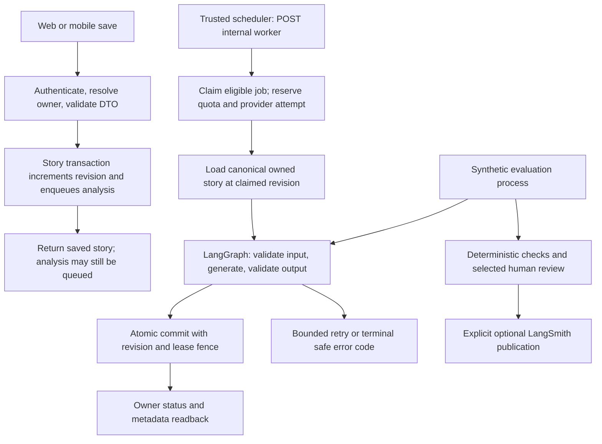

# AI runtime and operations

Implemented locally, with current repairs on `feature/production-audit-repairs`, based on `d0cb70220b3ab1b2c48261578205758d0d1db51e` plus uncommitted changes. This describes the candidate code, not an installed production system. See [evaluation commands and evidence limits](../evals/README.md), [the repair plan](PRODUCTION_AUDIT_REPAIR_PLAN.md), [release prerequisites](RELEASE_GATE_SETUP.md) and [the historical audit](PRODUCTION_READINESS_AUDIT_2026-10-26.md).

## Walk through the actual workflows

1. **Save and analyze:** `/api/journal/save` and `/api/stories` derive identity from authentication and normalize legacy mobile field aliases. Migration 020 enqueues eligible analysis in the story transaction. There is no self-HTTP dispatch or in-memory job set. The worker loads persisted content, never caller-supplied analysis text. Two attempts total, leased execution and source revisions prevent unlimited recovery or stale commits. A short story is saved without analysis. Analysis respects an existing `ai_readable=false` annotation. Edits invalidate derived metadata while preserving user annotations. Older metadata without revision evidence remains legacy evidence until a new result is generated.
2. **Read results:** the owner metadata API returns the current job state separately from metadata. Web/mobile polling is bounded; mobile pauses polling in the background. Refresh reads status; retry is allowed only within the total attempt budget. A saved story or accepted job does not imply completed AI analysis. Other-owner metadata reads are denied.
3. **Enhance and tracker:** authenticated synchronous routes validate size/task, reserve quota and a shared provider attempt, then run the same LangGraph text workflow. The tracker consumes `{text}`. No autonomous tools, checkpointer, repair loop or hidden retry is added. Preserving meaning still needs semantic evaluation; JSON validity cannot prove it.
4. **Weekly reflection:** the server loads up to 20 eligible recent stories for the authenticated owner, includes canonical context once, validates the output, and persists before returning success. Failure to persist returns failure. UTC window and attempt quotas constrain repeated generation. It is not a conversational memory agent.
5. **Transcription and patterns:** transcription retains its provider adapter, file validation and quota. Pattern aggregation remains deterministic. Neither needs an extra model or an autonomous agent. Audio quality, accent coverage and native capture still require real audio/device validation.
6. **Publication:** private cloud saves skip public IPFS pinning. Public pinning/audio require explicit public intent. Book compilation requires confirmation that selected content will become public. Private cloud audio upload is held until private storage is available; private text can still be saved. Transcription may send a recording to its provider even when it will not be published. Existing public content is not erased by this change.
7. **Payments:** confirmed signed receipts must match configured asset, network, wallet and recipient. A single transaction records the receipt, activates access and creates a notification outbox entry. Replays reuse the recorded expiry. A lower-plan payment during active Creator access becomes recorded deferred credit. The notice worker can activate due credit and sends an idempotent, frozen email payload. Provider acceptance is not inbox-delivery proof. Historical completed payments without an activation timestamp require reconciliation; they never silently grant another period.

CRE endpoints are inert. Trigger/callback return 410 and check returns an unverified coming-soon state. UI hooks do not poll or request verification. Archived code under `cre/parked-api/` is for investigation only. Existing contracts/testnet workflows are not evidence of the candidate's AI correctness or proof of human authorship.

## Configuration and operating limits

Configure secrets in the authorized environment; do not put values in this document or commit environment files.

| Configuration | Purpose |
| --- | --- |
| Existing Google provider key | Text generation; absent key fails before claim/admission |
| `AI_WORKER_SECRET` | Separate random bearer secret, at least 32 characters, for `/api/internal/ai-jobs` |
| `AI_DAILY_CALL_LIMIT` | Shared UTC daily text generation attempt cap; default 100, valid integer 1–100,000 |
| `PAYMENT_WORKER_SECRET` | Separate random bearer secret, at least 32 characters, for `/api/internal/payment-notices` |
| `BLOCKRADAR_ACCEPTED_ASSET_IDS` | Explicit comma-separated accepted asset IDs |
| `BLOCKRADAR_PAYMENT_NETWORK` | Explicit `testnet` or `mainnet` receipt acceptance |
| Existing Blockradar wallet/API/webhook configuration | Wallet binding, provider lookup and signature verification |
| Existing Resend key | Notification email provider; no key is needed for an in-app-only notice |

Keep `LANGSMITH_TRACING`, `LANGSMITH_TRACING_V2`, `LANGCHAIN_TRACING`, `LANGCHAIN_TRACING_V2`, `LANGCHAIN_VERBOSE` and `LANGSMITH_OTEL_ENABLED` disabled in private inference hosts. The runtime deliberately returns unavailable when an ambient flag enables tracing. Evaluate and publish synthetic cases in a separate process. Do not route production journal content into a LangSmith dataset.

Analysis defaults: eight active jobs globally, two per owner, 30-second leases, 60-second job deadline, at most two provider attempts and 25-second provider request timeout. Owner admission is ten analyses/hour; free accounts also have ten/month. Every retry consumes the global daily provider-attempt budget. Editing/tracker share 30 attempts/day per owner; reflection allows three attempts/UTC week. Story writes have a 100/day owner limit at the database trigger. These are explicit initial limits, not measured service-level objectives or unlimited paid-plan promises. The provider output cap is 4,096 tokens. Paid evaluation budgets are separate from these production attempt counters.

The job table stores analysis results/usage and owner identifiers. Retention, encrypted backups, deletion/opt-out propagation, operational access and logs need target-specific review. No raw provider exception is used as a client-facing job error. Leases and retries bound failure; they do not guarantee a provider will never charge for an ambiguous timeout.

## Rehearsal and rollout sequence

No target database, scheduler, provider or publication configuration was changed by this implementation. Review and rehearse these steps on a disposable/staging target before an authorized release:

1. Reconcile the actual schema/migration history against migrations 000–019. Back up through the database owner's supported mechanism. Preflight duplicate non-null payment address IDs/provider receipt IDs, existing completed payments, plan expiries, historical private publication and service-role counter callers. Resolve anomalies through an audited reconciliation; do not delete business rows to make a unique index fit.
2. Apply reviewed migrations **020, 021, 022** in order. Each is transactional. Test actual authenticated/anonymous/service roles, storage policies, auth resolution and every RPC grant on the target. PGlite proves local SQL behavior, not effective deployed privileges.
3. Deploy compatible API and web/mobile contracts together in staging. Exercise save → durable job → worker → metadata, ownership denial, edit/delete during work, quota exhaustion, retry exhaustion and opt-out. The analysis endpoint returns 202 for queue-aware pending requests. Legacy requests containing `storyText` receive 409 while pending, preventing old clients from interpreting acceptance as completed metadata; completed requests receive current persisted metadata with 200. Source content remains canonical. Short and oversized grandfathered content does not enqueue analysis. Verify direct and linked-account identity resolution using the release prerequisites. Keep worker dispatch held until compatible clients are available. There is no fallback inline inference path if migration/configuration is absent.
4. Configure separate worker secrets and provider acceptance/budgets. Install a trusted scheduler calling each internal **POST** endpoint with its matching bearer token. An AI invocation processes at most one job. A payment-notice invocation can activate one due credit and dispatch one notice. Choose cadence/concurrency from measured queue age and provider limits, with bounded scheduler retries and jitter. No public client should know either secret. No platform scheduler was installed in this change.
5. Test crash/replay and competing claims using multiple real PostgreSQL connections. Test actual signed provider receipts, late/deferred credits, missing confirmation, wrong asset/network/recipient, reconciliation and outbox ambiguity in a provider sandbox. Verify frozen retry payloads and the provider's idempotency window. Do not use real customer funds/email for rehearsal.
6. Measure queue age, active/expired leases, failure codes, attempts, stale/superseded results, reserved daily calls, provider usage/cost, latency, deferred-credit age and failed outbox entries. Monitor aggregates and identifiers with controlled access; avoid journal/audio/email bodies. Alert thresholds require baseline traffic measurements. Reconcile reserved calls and provider billing; do not assume equal counts.
7. Complete reviewed holdout quality, real audio, authenticated browser/device, accessibility, production build and dependency gates. Bind all evidence to the candidate's exact commit/artifact/environment. Follow the installed production release-audit skill before any production side effect and again for exact-artifact delivery. A local test pass does not authorize release.

Existing stories are not bulk-enqueued by migration 020. An owner can request analysis through the compatibility endpoint, or an authorized bounded backfill can be designed separately. Do not launch an unbounded historical backfill or reset attempt counters. Legacy completed payments and deferred credits must be operationally visible before accepting more payments.

## Containment and recovery

Pause the scheduler or remove its endpoint access to stop new background claims. Disable the provider key or tighten the global attempt cap to contain synchronous spend. Preserve failed jobs and receipts for investigation; never reset attempts to recover an exhausted job. Existing leases expire, but an already dispatched provider request may still be billed.

Prefer an additive forward fix. Rolling back application code to the old fire-and-forget/payment implementation while keeping these migrations can create contradictory behavior. Do not drop job/outbox tables, discard receipts or remove constraints as a quick rollback. Rehearse a compatible rollback artifact and data reconciliation with the database owner.

Remaining release work includes effective production RLS/storage validation, upload/inference cost controls beyond current request caps, real concurrent load, provider contract validation, calibration of semantic evaluators, authenticated web/native journeys, artifact delivery evidence and the broader page/feature improvements from the plan. This local implementation does not resolve every production-audit finding.
