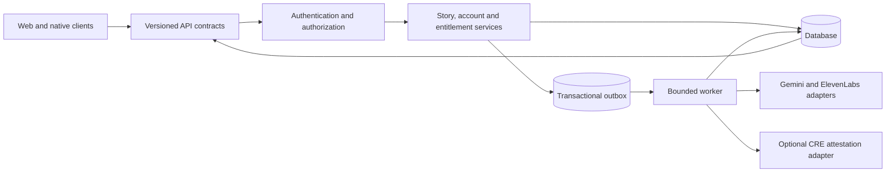

# iStory platform improvement guide

Prepared 2026-10-26 from the current repository and [production audit](PRODUCTION_READINESS_AUDIT_2026-10-26.md). This is a prioritized implementation guide, not a claim that every page has been visually tested or upgraded.

The goal is a dependable journaling and storytelling product with clear ownership, truthful AI behavior, consistent interactions and measurable performance. The origin of code cannot be inferred from its appearance. The useful targets behind “remove vibe-coded patterns” are unsupported claims, inconsistent contracts, decorative repetition, incomplete error handling, duplicated business logic and missing acceptance evidence.

## 1. Fix trust and correctness before visual changes

| Order | Change | Acceptance evidence |
| --- | --- | --- |
| P0 | Prevent unencrypted private stories from being pinned publicly | Private-save regression observes zero plaintext IPFS requests; explicit public publication remains separate |
| P0 | Triage and patch runtime framework/Sentry/dependency advisories | Reachability notes, reviewed lockfile, clean applicable advisories, build and browser/device regressions |
| P0 | Make privacy, ownership, deletion and CRE claims match actual data flow | Product/privacy review cross-references storage and provider behavior; remove unsupported absolutes |
| P1 | Repair mobile `{text}`/`enhanced` and metadata response contracts | Mobile caller tests through enhancement/save/library readback |
| P1 | Make payment-to-entitlement and AI/CRE completion recoverable | Fault-injection tests at every persistence/provider boundary and a reconciler with an owner |
| P1 | Restrict or authorize privileged counter RPCs | Actual role/ACL rehearsal and denied anon/other-owner calls |
| P1 | Establish exact-artifact release gates and signed-device acceptance | CI/provider ordering, full source/artifact identity and per-target audit evidence |
| P2 | Consolidate page structure, tokens, copy, interaction states and accessibility | Approved page screenshots, keyboard/screen-reader checks and feature journey tests |

Do not combine a provider/database migration, major framework upgrade, auth rewrite and visual redesign in one PR. Preserve user data and compatibility while each change earns independent evidence.

## 2. Conventional architecture to grow from

Keep a modular monolith until measured load or organizational boundaries justify separate services. Next.js APIs, PostgreSQL/Supabase, a durable worker and explicit provider adapters are enough for the current feature set. New infrastructure should solve an observed bottleneck.

Suggested boundaries, introduced only as the relevant feature changes:

- Route layer: input validation, trusted identity, object authorization, quota decision, HTTP mapping.
- Domain services: story revisions, publication/privacy, subscriptions, collections, safety/blocking, AI job state.
- Infrastructure adapters: database, object storage, IPFS publication, provider models, email, payments, CRE/chain.
- Client contracts: shared runtime schemas and explicit response versions; separate web/native presentation code.
- Evaluation: deterministic task/workflow/journey checks, plus reviewed semantic benchmarks where needed.

Routes should not each reinvent identity mapping, prompt construction, entitlement calculation and provider retry policies. Avoid importing admin clients or server keys into shared client modules. Maintain the Firefox same-origin refresh proxy and existing Web Lock constraints; an auth refactor requires its own regression scope.

## 3. Data and distributed work

Use stable tenant/profile IDs internally. Record story revision/content hash, public/private state, author, and original input provenance separately from AI-generated text. Keep user-selected key moments separate from inferred significance.

For background analysis, use a durable job/outbox keyed by `(tenant, story, revision, task, prompt version, model version, schema version)`. An atomic claim/lease coordinates workers; a unique constraint prevents duplicate active jobs. Persist attempt count, next retry time, deadline, last safe error code and completion evidence. A bounded retry policy distinguishes temporary provider failures from invalid input and permanent authorization failures.

Store provider delivery, persistence and optional attestation as distinct states. Recovery should not mark a job complete before required writes succeed. Expired leases and stuck jobs need a reconciler and a visible failed state. An HTTP 200 or accepted trigger is not a completion record.

Use keyset pagination and bounded selections for libraries, feeds, comments and notifications. Inspect actual query plans and index the real owner/date/filter access patterns before adding speculative indexes. Avoid loading every story to compute a monthly count at large scale; add indexed aggregates only when measured. Rehearse effective grants, RLS, RPC permissions and concurrent transitions with real PostgreSQL; query doubles cannot establish them.

Separate private object delivery from public publication. Signed media URLs need expiry, owner authorization, cleanup and revocation behavior. Account deletion needs cross-system reconciliation and honest immutable-public-data disclosure.

## 4. Efficient and safe inference

1. Compute word counts, quotas, tier/threshold mapping, aggregation, formatting and schema checks in code.
2. Reuse a valid analysis for the same tenant/content revision and exact model/prompt/schema configuration. Do not globally cache private journal outputs across accounts.
3. Use the smallest model that meets reviewed per-workflow quality thresholds. Compare on the same held-out cases; do not choose a model from a marketing benchmark alone.
4. Bound input bytes/tokens, output tokens, attempts, per-job deadline and concurrent provider calls. Reject oversized input before expensive parsing where supported by the hosting platform.
5. Apply shared per-user/tenant budgets and global provider concurrency, with bounded queues and admission control. A process-local map is only a local optimization.
6. Prefer asynchronous delivery for non-interactive analysis/reflection/attestation. Preserve responsive local editing and show pending/failed/retry states.
7. Keep optional attestation off the critical save path. Measure the extra model calls, consensus failures, execution fees, gas and callback recovery before retaining it as a default dependency.
8. Treat story text and model responses as untrusted data. Validate outputs and tool effects; content delimiters and lexical checks are not a complete prompt-injection defense.

Track provider/model/version, prompt hash, actual token/audio usage, cache hit/miss, attempts, throttles, queue age, target latency and total completion time. Separate target and judge spend. A fixture graph's millisecond timing is not production inference latency; absent pricing/usage is unknown cost, not zero.

Set numerical budgets from measured baselines and agreed product SLOs. Start with a budget sheet per workflow containing max input/output, max attempts, concurrency, deadline, daily spend cap, quality threshold and fallback behavior. Recheck current provider pricing and model availability during implementation.

## 5. Evaluation-driven and test-driven delivery

Use the [evaluation implementation](../evals/README.md) and existing web/mobile tests.

| Question | Preferred check | When a judge is justified |
| --- | --- | --- |
| Is the function/API correct? | Vitest, schemas, actual-handler tests | Never for status fields or arithmetic |
| Are access controls and quotas enforced? | Owner/other-owner/anonymous tests plus real DB role/concurrency rehearsal | Never as a substitute for authorization tests |
| Did a workflow actually complete? | HTTP/browser/native journey, persisted state and fault injection | Never to infer delivery from prose |
| Is transcription accurate? | WER, critical names/numbers/negation, human audio spot checks | Only for semantic ambiguities not captured by references |
| Did editing preserve meaning and voice? | Protected-fact regression plus human review | Calibrated judge for broader semantic/voice comparison |
| Is a reflection grounded and helpful? | Correct source selection, references, human rubric | Calibrated semantic judge, with human disagreement review |
| Is attestation valid? | Binding/hash/receipt/contract/workflow verification | Never for cryptographic proof validity |

For every change: write a failing meaningful test, make the smallest coherent fix, run the targeted tests, then run milestone typecheck/build and affected journeys. Negative controls must show the evaluator fails on fabricated entities, changed negation, invalid fields, missing results, wrong ownership and failed persistence.

Keep unit, API integration, real-database, browser, signed-native, live-provider and load suites labeled separately. Do not let `it.fails` known-defect tests become an implied release waiver. Human-calibrate semantic judging before turning it into a required quality gate. Expand small datasets before using aggregate scores as general safety or fairness claims.

## 6. Design principles tied to the product

The current source mixes editorial typography, glass cards, repeated gradient headings, global 3D scenery and inline color values. None of these is inherently wrong. Repetition and competing hierarchy make the experience feel assembled rather than designed around reading and writing.

- Give story text the main visual role: readable width, stable type scale, generous line height, quiet backgrounds and clear chronology.
- Use one primary action per page and descriptive secondary actions. AI is an explicit tool with an editable result, not a decorative badge on every interaction.
- Consolidate semantic tokens for surfaces, text, borders, actions and states. Resolve the overlapping OKLCH/HSL definitions in `app/globals.css` against the actual token consumers; do not just delete one layer without visual regression evidence.
- Keep the brand mark and a small purposeful accent palette. Use gradients or glow only where approved by the design system, rather than repeating them on headings, buttons, notifications and every card.
- Limit shadows, glass and blur on dense content. Check actual contrast; no contrast ratio was measured in this source-only review.
- Make the global 3D background optional and absent on focused writing/reading or reduced-motion paths unless user research supports it. Measure main-thread work, bundle loading, battery and low-end-device behavior before choosing the treatment.
- Consolidate toast systems and state conventions. Success means the required operation completed; an accepted background job needs a pending message.
- Do not replace page-specific writing with generic “unlock,” “transform,” “journey,” “perfect,” or grand privacy guarantees. State what the user can do and where data goes.

## 7. Page-by-page upgrade plan

These are source-informed proposals. Screenshot and interaction review on real supported viewports is still required before visual implementation is accepted.

| Page/feature | Upgrade | Acceptance criteria |
| --- | --- | --- |
| Home | Lead with recording/writing and actual benefits; remove unsupported statistics, perfect-transcription and absolute encryption claims; shorten repeated feature sections | Every public claim maps to tested behavior or a cited source; clear primary recording CTA and readable mobile layout |
| Onboarding/auth | Explain required versus optional profile fields and privacy choices; preserve drafts and return destination | OAuth/wallet/email paths supported by the selected distribution pass refresh, expiry, reset, cancellation and error journeys |
| Record | Clear mode choice, recording state, transcript/edit history, enhancement preview/revert and private/public decision | Keyboard/screen reader controls; permission denial and failed upload recovery; private save never performs unintended public publication |
| Tracker | Show supplied habits/mood/notes before generation; correct response DTO; make generated provenance editable | Both platforms create and save the same intended facts; no invented completed habits; visible no-data and failure states |
| Library | Prioritize story chronology/search/filter; quiet row/card styles; server-backed pagination and metadata delivery | Dates/counts accurate, empty versus failed states distinct, owner isolation and large-library performance measured |
| Pattern/theme/domain views | Explain that labels are AI interpretations; show source stories and allow correction where product policy permits | Correct grouping from actual received metadata, no fabricated trends when inputs are missing, navigable source links |
| Story reader | Readable text and metadata hierarchy; separate private audio, author controls, reactions, insights and proof | Owner/non-owner/public/private tests; accessible audio and real server-enforced paid content policy if enabled |
| Collections | Make add/remove/reorder/state consistent and reversible where possible | Ownership, duplicate additions, empty collection, pagination and failed writes covered |
| Books | Preview exact selected content and publication consequences before compilation/mint | Ownership and complete selection verified; public/immutable publication is explicit; interrupted compilation recoverable |
| Social | Focus on public stories and safety; bounded feed/comments; honest unavailable state | Public/private filtering, block/report, pagination and failed-network handling tested; no content leakage behind a paid UI |
| Profile/settings | Separate identity, subscription, privacy/export/deletion and reading preferences into clear sections | Account switch clears the correct owner-scoped caches; deletion partial failures recover; controls reachable at large text sizes |
| Public profile | Show only intended public fields/content and consistent report/block actions | Private data and blocked-user projections tested from anonymous and authenticated callers |
| Weekly reflection | Show selected date range, source count and source entries; distinguish generated-but-unsaved | Frozen-time window tests, honest empty week, cooldown/plan enforcement, grounding review and persistence evidence |
| Pricing | Describe exactly which features are available on each platform and plan; remove unsupported outcome promises | Expiry, upgrade/downgrade and payment retry tested; native consumption-only flavor does not expose unsupported purchase steering |
| Notifications | Calm unread hierarchy, predictable read state, clear destinations and empty/error modes | Owner isolation, pagination, safe links, notification settings and account-switch behavior verified |
| Waitlist | Concise purpose, minimum input and specific validation/consent copy | Duplicate submission, rate limits, email errors and success contract covered |
| Privacy/terms/deletion/community | Reconcile promises with providers, IPFS, vault/cloud distinctions, moderation and retention | Accessible public links; complete deletion and support process; reviewed factual accuracy without blanket legal-compliance claims |
| Unsubscribe | State what changed and permit recovery where appropriate | Signed token/recipient binding, repeat requests, invalid/expired links and no arbitrary-recipient changes |

## 8. Native-specific design and reliability

Keep mobile work inside `mobile/`. Reuse domain contracts, not web layout components. Use native keyboard avoidance, safe areas, permission explanations, platform audio behavior, accessible touch targets and dynamic text sizing.

Prioritize cold start, interrupted recording, offline drafts, background/resume, process death, token refresh and replay after account switch. Persist no bearer tokens in mutation queue payloads. Queue entries need explicit owner/idempotency scope, bounded attempts and a recoverable exhausted state. Verify idempotency on the server as well as the client.

Use the actual signed release flavor for acceptance. Google Play consumption-only source flags are an existing product choice; confirm shipped behavior and current policies before adding payment/wallet features. Test Android links with the installed signing certificate and iOS Universal Links with actual entitlements/AASA. Expo Go, exports and Jest native mocks cannot establish these behaviors.

## 9. Accessibility and visual acceptance

Use semantic controls and visible focus. In the current record page, the private/public toggle is a clickable `div` (`app/record/RecordPageClient.tsx:747`); implement an accessible switch/button with state and keyboard behavior in a future fix. The FAQ buttons need expanded-state/control relationships. Icon-only controls need names. Test rather than infer compliance from component-library use.

For each changed page capture light/dark states, narrow/wide viewport, loading/empty/error/success, keyboard navigation, reduced motion and 200% text/zoom behavior. Verify VoiceOver/TalkBack and native large-font behavior separately. Use a small set of reviewed visual snapshots; avoid brittle full-page snapshots that only preserve existing clutter.

The current [web-interface guidelines](https://raw.githubusercontent.com/vercel-labs/web-interface-guidelines/main/command.md), checked 2026-10-26, inform semantic controls, focus, forms and reduced-motion checks. This guide does not claim a completed WCAG conformance audit.

## 10. Work packages and review standards

1. **Trust repair:** private publication boundary, factual copy, dependency triage, recoverable payment/verification states.
2. **Contract repair:** mobile tracker, metadata delivery, identity mapping and shared request/response schemas with compatibility tests.
3. **Durable operations:** outbox/worker, shared cost controls, observability, pagination and database permission rehearsal.
4. **Product foundation:** token/type/spacing/action/state conventions, accessible primitives and one reviewed reference page.
5. **Feature passes:** recording first, reading/library second, tracker/patterns third, then settings/social/books/pricing/support pages.
6. **Measured optimization:** compare model candidates, inference reuse, bundle/startup/query performance and physical-device resource usage against budgets.
7. **Release acceptance:** source/artifact binding, critical real journeys, restore/rollback proof, per-target production audit and delivery verification.

Each PR should identify the concrete user failure, narrow resulting behavior, tests added before the fix, verification actually run, compatibility impact and remaining risk. Reject dead feature stubs, magic fallback scores shown as insight, hidden catches that fake success, duplicated contracts, speculative abstraction layers, enormous unrelated cleanup diffs and unsupported performance claims.

Done means a user can complete the intended task reliably, understand the data/privacy implications, recover from an error, and receive a result supported by evidence. A new visual style or a high aggregate evaluation score alone is insufficient.
