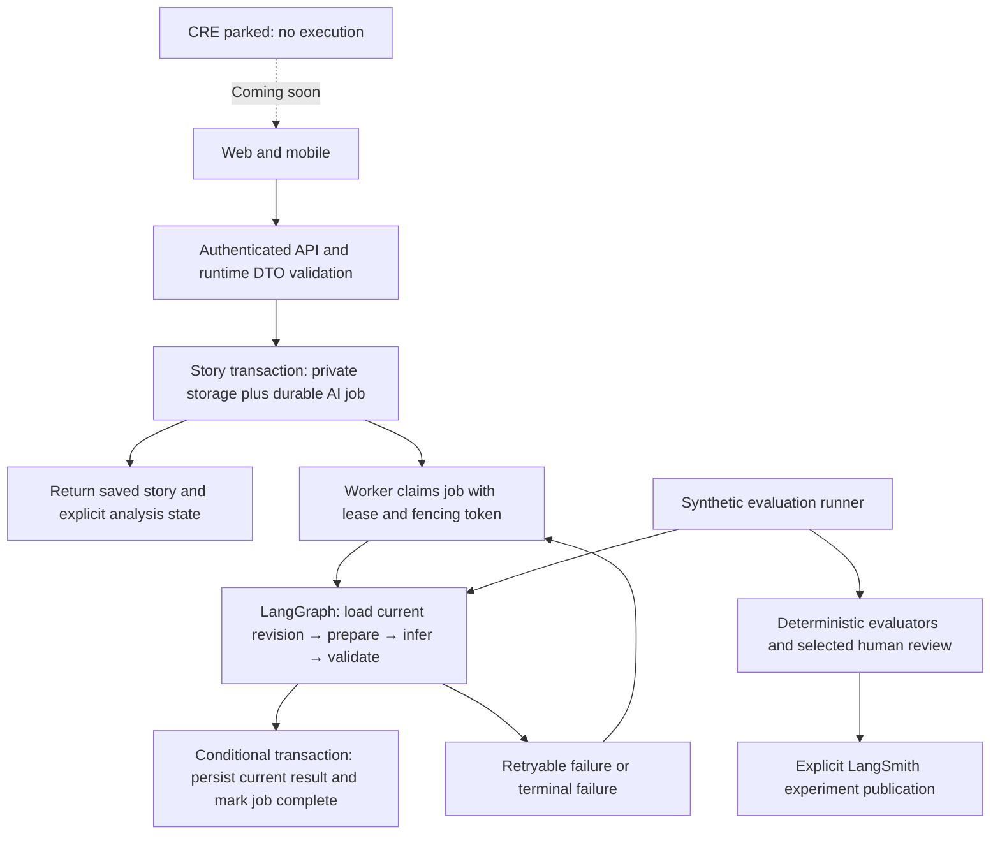

# Production hardening and AI evaluation implementation plan

Date: 2026-10-27. Status: approved implementation plan, with local implementation now underway/completed by workstream; no production readiness or release approval. See [the 2026-10-28 implementation evidence](IMPLEMENTATION_STATUS_2026-10-28.md) and [runtime operations](AI_RUNTIME_AND_OPERATIONS.md) for current results and remaining work. The baseline and red-phase observations below are retained as historical evidence.

This plan implements the findings in [the production audit](PRODUCTION_READINESS_AUDIT_2026-10-26.md), with the user's newer decision to park CRE. It supplements [the workflow walkthrough](AI_AGENT_WORKFLOW_WALKTHROUGH.md), [the evaluation guide](AI_AGENT_EVALUATION_IMPLEMENTATION_GUIDE.md), and [the platform improvement guide](PLATFORM_IMPROVEMENT_GUIDE.md). Those documents contain historical descriptions; this plan governs the proposed target behavior. Keep the audit intact as historical evidence.

## 1. Engineering judgment

The immediate risks are private-content publication, false verification claims, unrecoverable business transitions, inconsistent client contracts, and missing evidence. Replacing an orchestration library alone cannot resolve these risks. Address them in that order, with independently reviewable changes.

Use LangGraph for the explicit AI workflow requested by the user. Use LangSmith for controlled experiments and evaluation results. LangSmith does not require that the whole app become a graph. Keep authentication, subscriptions, story CRUD, payment accounting and database authorization in ordinary application services. Pattern aggregation remains deterministic code. Transcription remains a provider adapter with deterministic file validation; it does not need an extra generative model.

Do not create a second autonomous "evaluation agent" with production tools. The evaluation runner executes a versioned target against fixtures and scores observable results. It must have no authority to publish content, pay, modify entitlements, submit transactions or change production data.

CRE is parked, rather than deemed valid or permanently deprecated. Testnet status does not establish proof correctness. The UI will say **On-chain verification — Coming soon** and will not display consensus, enclave, tamper-proof quality, verified badges or pending-verification claims. AI-derived scores are interpretations, not attestations.

## 2. Current state and evidence limits

Baseline inspected: `master`, commit `d0cb70220b3ab1b2c48261578205758d0d1db51e`, plus an already dirty workspace. Preserve all unrelated user files and changes. A HEAD SHA alone does not identify this candidate. Current implementation branch: `feature/ai-workflow-cre-park`; existing dirty files were carried without committing them.

Some local changes began before the user's request for this detailed plan: parked CRE handlers/hooks/UI, a prototype shared text graph, route integration, dependency edits and new regression tests. They are **work in progress**, not an accepted implementation. Privacy publication, journal dispatch, mobile DTOs, public copy and evaluation references still need the work below. No migration, model request, LangSmith publication, chain transaction or deployment was intentionally performed.

Fresh targeted checks on 2026-10-27:

- The proposed graph passed three checks for empty output and provider failure, but failed its ambient-tracing no-egress test: a mocked fetch observed a LangSmith `/info` request. This is evidence that the disabled wrapper is insufficient for the proposed contract, not evidence that journal content was transmitted. Privacy isolation is a blocking design gate.
- CRE/publication test suites could not import `next/server` while package installation was modifying `node_modules`. An earlier attempt could not resolve Rollup. These are invalid test-environment results, not product passes or meaningful red-phase proof.
- Dependency installation completed with lifecycle scripts disabled (63 packages added, 58 removed, 44 changed). Verify the resulting versions and lockfile before acceptance. Do not overlap package installation with tests/builds again.
- After installation completed, the targeted suites loaded: six checks passed and three failed (the tracing no-egress check and both private/unconfirmed publication rejection cases). The parked endpoint checks passed. The new publication regression is still red; containment has not been implemented. After changing the CRE harness to static imports, all three parked-endpoint checks passed again (2026-10-27).
- Current root TypeScript check (`node node_modules/typescript/bin/tsc --noEmit --incremental false`) passed after installation. The post-edit hook itself fails on its existing ESM `__dirname` usage for TS files, so the explicit compiler result is the evidence. No new full build, browser, native/device or live-provider pass is claimed.
- Installed versions checked: Next 15.5.28, Sentry 10.75.2, sharp 0.35.5, LangChain core 1.3.0, LangGraph 1.5.2 and LangSmith 0.11.1. Fresh advisory triage is still required.
- The earlier audit's unit/type results apply to its earlier workspace. Do not carry them forward as evidence for these edits. Its web production build/browser gates were not established.

No current release decision is upgraded: web/API and Android remain NO_GO under the recorded audit; iOS and OTA remain BLOCKED pending their own evidence. This plan is not a fresh full production audit.

## 3. Invariants and threat model

| Boundary | Required invariant | Negative proof |
| --- | --- | --- |
| Private story → public network | Private save never publishes raw story/audio/metadata to public IPFS | Spy on actual save and upload boundaries; private, omitted visibility and conflicting visibility requests make zero pinning calls |
| Client → privileged API | Identity is derived from verified auth; ownership and subscription are checked server-side | Anonymous, other-owner, forged author, expired entitlement, cookie-only and bearer cases |
| API → provider | Schema, size, quota and ownership checks precede spend | Invalid or denied requests cause zero inference calls |
| Provider → app | Model output is untrusted and schema validated | Empty, malformed, oversized, extra-field, adversarial and unsafe rendering cases |
| Worker → persistence | Only the current owned story revision can receive a result | Edit/delete/account-switch during execution cannot attach stale output |
| Runtime → tracing/logging | Raw journals, audio, credentials and provider error payloads do not reach telemetry | Canary content capture across SDK, graph, nested callbacks, logs and delayed flushes |
| Webhook → entitlement | A valid payment cannot be lost between receipt and entitlement activation | Crash/retry/concurrent replay at every write boundary |
| Old client → parked CRE | Old requests cannot trigger model, callback storage or chain work | All old endpoints, including duplicate callbacks, stay inert regardless of env flags |
| Evaluation → target | References, labels and expected outputs never enter inference | Request capture and deliberately corrupted reference/target tests |

Prompt delimiters are useful organization, not a security boundary. Current tasks must not receive unrestricted tools or arbitrary outbound destinations. Treat all story content as data; no instruction in a journal can authorize application side effects.

## 4. Target design

The worker, domain services and graph are separate boundaries. The graph cannot trust a client-supplied principal or arbitrary story text as authoritative persisted content. Pass a server-established job identity; load and verify the owned revision before inference. A small graph with named stages is sufficient; no multi-agent planning loops, vector database or generic tool framework is justified by these workflows.

### Durable jobs and concurrency

Prefer the existing Postgres/Supabase stack for the first durable job/outbox implementation. Do not couple this work to a provider migration. Select the actual authenticated worker/scheduler entry point from the hosting capabilities before coding its dispatch; an undocumented cron or a Next.js post-response callback is not a durable queue.

Proposed job fields: internal ID, owner ID, story ID, story revision, task, prompt/model/schema versions, state, attempt count, available time, lease expiry, fencing token, error code and timestamps. Unique job identity includes owner, revision, task and all versions that affect results. No raw journal text or bearer tokens in the queue payload. Use protected revision identifiers; never expose private content hashes as public proofs.

State machine: `queued → running → succeeded`, with `retry_wait`, `failed`, and `cancelled` transitions. Claim atomically with a database lease, not a process-local Set. Bound attempts, lease time and age. An expired lease can be reclaimed; an old worker's fencing token cannot commit afterward. A permanent or exhausted failure is visible and recoverable through an authorized retry operation.

Story insert/update and job enqueue must commit atomically. Result upsert and job success must also commit atomically, conditional on current revision and lease. Reject stale results after edits; cancel or discard work for deleted stories. Test real transaction behavior in an isolated database; query doubles cannot prove it.

Delivery is at least once. An external provider call cannot be made exactly once by a database transaction. A worker can crash after the provider charged but before the result persisted. Record attempts, bound duplicate spend and use provider idempotency only where actually supported. Do not promise zero duplicate billing.

### Graph and provider responsibilities

Extract shared prompt builders, input preparation, strict output parsers and provider adapters from routes. The same implementation must be invoked by production and model evaluation. Graph stages: prepare authoritative input, invoke the approved adapter, validate task output, return a typed result. Worker/service owns durable state and commits.

Keep one retry owner. Remove nested route/SDK/graph/worker retry multiplication. Distinguish transient provider errors (eligible for a bounded retry) from validation, permissions and invalid-output failures. Respect Retry-After within the remaining deadline; use backoff with jitter. Automatic repair/model-judge calls are off by default.

Privacy must be proven against the installed SDK versions. The current `traceable(..., { tracingEnabled: false })` prototype failed the stricter no-egress test. Investigate an explicit tracing/callback configuration and client isolation, or remove the prototype integration until it can satisfy the contract. Do not disable tracing by mutating global environment variables per request. Do not ship a global fetch monkey patch. Test concurrent private and evaluation runs to prevent context bleed.

Initial production policy: no LangSmith journal/audio traces. Synthetic experiments run separately with an explicit LangSmith client/project. Metadata-only operational metrics use an allowlist: task/version, status, duration, token/audio usage, attempts and opaque internal correlation ID. Sanitize errors; remove raw model previews from analysis logging. Hiding inputs/outputs alone does not prove metadata, exception text or nested traces are safe.

## 5. Delivery sequence and acceptance

Use short-lived `feature/*` branches and small reviewable changes. Dependency changes follow the repository's master-first instruction; do not commit unrelated existing work. Do not merge, change provider settings or publish as an automatic consequence of completing a work package.

### P0 — Stabilize the candidate and establish a trustworthy test environment

- Finish dependency installation, inspect package/lockfile diff and confirm runtime dependencies include graph SDKs only if app code imports them.
- Use one documented supported Node toolchain matching CI; revalidate package engines and native build assumptions. The local Node 25 environment and CI Node 22 are currently different.
- Confirm installed versions, fresh runtime/full/mobile vulnerability reports and affected import paths. Review the selected Next/Sentry/sharp patches; no blind force-upgrade.
- Move isolated implementation work to a feature branch without losing user changes. Identify every owned change and current unverified behavior.
- Fix test harness imports/dynamic import patterns and rerun serially. A meaningful red test must fail for the behavior under test, not missing dependencies.

**Exit:** reproducible dependency installation; exact candidate diff; targeted tests load successfully; no unreviewed install artifacts. Dependency security is not cleared until fresh audits and affected regressions pass.

### P1 — Contain privacy and remove misleading verification

Files: record page, IPFS service/upload route, all public pinning callers; CRE routes/hooks/components; mobile story detail; homepage/pricing/FAQ and relevant docs.

1. Write regression tests against the real private-save path and server upload handler.
2. Skip public IPFS entirely for private stories. Require explicit public publication at the server boundary; reject `is_public: false` even if another field says public. Bound metadata bytes, validate multipart shapes and distinguish malformed input from server failure. Keep current public book/mint workflows working only after confirming exactly what content becomes public.
3. Review private audio uploads and storage policies separately; fixing text publication does not establish private audio protection. Define private cloud storage versus optional encrypted local vault accurately.
4. Park CRE trigger/callback with explicit disabled responses (proposed HTTP 410); check returns an unverified coming-soon result with no metrics/proof. No provider, DB or chain calls. No env toggle can silently re-enable it.
5. Stop all client triggers/polls and remove verified/pending claims from both clients, marketing and active evaluation cases. Retain historical contracts/code/data for a future independent review; no deletion or on-chain mutation. The user's latest parking decision supersedes the old audit's recommendation to retain active legacy proof reads.
6. Update unsupported privacy, perfect-transcription and enclave/consensus claims to match actual behavior. State that AI features send input to their configured provider.

**Exit:** private saves have zero pinning calls; public publication requires explicit intent; legacy CRE requests are inert; stale cached metrics cannot produce a verified badge; both clients visibly say coming soon where relevant. No claim that previously published IPFS content has been erased. Any historical exposure requires an owner-led incident assessment with separately authorized data access.

### P2 — Repair API contracts and recoverable business state

Files: journal save, stories list, mobile tracker/patterns, payment webhook/services and isolated database migrations/tests.

- Define runtime-validated request/response DTOs. Resolve identity consistently. Preserve documented old camelCase/snake_case payload aliases during the compatibility window; reject contradictory aliases rather than guessing. Validate content limits, audio fields, parent ownership, visibility and dates.
- Fix mobile tracker to consume `{ text }` and show actionable failed/empty responses. Separate tracker generation from editing with an explicit task and validated structured facts; do not smuggle instructions through a generic text field.
- Return an owner-scoped paginated story projection with normalized metadata and the author shape mobile actually consumes. Avoid exposing every database column. Test absent metadata, relation array/object shape, deleted authors and empty/error states.
- Fix payment recovery before adding subscription behavior: atomically record verified event receipt and the entitlement transition, or durable activation work. Deduplicate by authenticated provider event/transaction identity, not only pending payment address. Model underpaid, duplicate, replay, pending activation and completed states explicitly.
- Commit notification/email work as a separate outbox effect; failure to send email must not roll back a valid entitlement. Test repeated activation cannot extend or downgrade an entitlement unintentionally. Inspect actual `activateSubscription` effects before choosing the transaction boundary.

**Exit:** web/current mobile/known old payload contract matrix passes; other-owner writes fail; simulated activation failure can recover with one intended entitlement; duplicate/concurrent/out-of-order events are safe. No production payment or email is used as a test.

### P3 — Install the durable AI execution path

- Write isolated-DB transaction, lease, fencing, revision and crash-recovery tests first.
- Implement the additive job schema and trusted claim/complete/retry operations with least-privilege grants. Review SECURITY DEFINER search paths and caller authorization; no public execute on privileged state transitions.
- Make journal saves enqueue atomically. Return saved versus analysis-pending state honestly; retain compatible fields for older clients.
- Extract shared services and integrate the small LangGraph target. Replace unawaited self-HTTP calls and process-local deduplication. A temporary managed post-response callback may reduce dropped work but does not satisfy this phase's durability gate.
- Provide status retrieval and manual retry under ownership, quota and idempotency rules. Persist no authentication credentials in queued jobs. Reserve quota atomically per accepted job and account actual attempts separately.
- Deployable migrations/worker configuration are reviewable artifacts only at this stage. Applying them externally is a separate execution step with prerequisites and rollback.

**Exit:** terminate workers at every boundary, expire leases, run two workers concurrently, edit/delete stories mid-run, fail provider/persistence and prove recovery without false success or stale writes. Graph succeeds without CRE or LangSmith availability. Lease/job authorization is proven with real database roles.

### P4 — Make evaluation measure the real implementation

- Update the workflow walkthrough and dataset taxonomy: analysis, editing, tracker generation, reflection, transcription and deterministic patterns. CRE parking is a security/compatibility regression suite, not an AI quality score.
- Retain fast Vitest correctness checks and actual-handler integration tests. The existing fixture CLI only proves harness wiring; it remains ADVISORY. Remove stale known-defect text only when associated tests prove closure.
- Add a product-target evaluation adapter invoking the shared production prompt/parser/graph with replaceable providers. Route-mock tests and live-provider evaluations must be different labeled modes.
- Build a versioned, synthetic or consented/de-identified holdout dataset. Start with 30 reviewed cases per generative workflow as a coverage seed, not a statistical safety guarantee. Include sparse/empty entries, dates/time zones, negation, names/numbers, mixed language, grief/distress, long inputs, prompt injection and changes in story revision. Add representative audio with rights and references for transcription.
- Keep references out of target requests; fix train/test contamination and verify evaluators against intentionally bad outputs. Store dataset/prompt/model/schema/code versions and exact candidate fingerprints.
- Use deterministic evaluators for schemas, ownership, quotas, source selection, aggregates, word limits, missing results, retries and delivery. For transcription use WER plus names/numbers/negation error checks. Lexical protected-fact checks are useful regressions, not proof of semantic fidelity.
- Use human review and a calibrated LLM judge only for meaning preservation, reflection grounding/helpfulness and tone when deterministic checks cannot decide. The judge sees untrusted candidate text, has no tools and cannot override failed safety or correctness gates. Blind and randomize pairwise comparisons; record disagreements and recalibrate on human-labeled examples.
- LangSmith publication is explicit and initially synthetic-only. A service outage must not affect story save or production inference. Distinguish zero-cost mock runs from unknown or measured live inference cost.

**Exit:** negative controls demonstrably fail; same target code as production; no reference leakage; deterministic suite green; held-out human review complete; judge agreement and threshold policy recorded before making semantic quality a blocking gate. Incomplete suites are INCONCLUSIVE, never PASS.

### P5 — Hardening across security, scale and product quality

- Audit every owner/public/paywalled read projection, direct Supabase client/RPC path, storage bucket and service-role call. Test RLS/grants with actual isolated roles, including missing identity and blocked/deleted users. UI visibility is not authorization.
- Verify cookie/bearer auth, CSRF/origin behavior, session expiry and account-switch cache isolation. Preserve Firefox refresh proxy and auth subscription invariants; never wrap Supabase auth in Promise.race.
- Add bounded pagination and indexed queries based on query plans; test against realistic cardinality. Load test quotas, job claims and provider backpressure at multiple worker counts. Do not add a cache until invalidation, owner partitioning and measured benefit are defined.
- Verify encrypted mobile token storage, recording permissions/interruption, offline draft ownership, idempotent replay and logout/account-switch behavior. Server job recovery and mobile mutation replay must not duplicate the same story/action.
- Apply page improvements from the existing platform guide in feature slices: record/tracker/story/library first, then patterns/reflection, social/books, settings/pricing/legal. Favor readable text, consistent state handling, accessible controls and measured performance over a cosmetic redesign.
- Remove dead flags, copied scaffolding and redundant abstractions only after callers/tests identify safe removal. "No vibe coding" means reviewed contracts, cohesive modules, truthful copy, reproducible checks and designed states; visual minimalism alone is not engineering quality.

**Exit:** each feature has owner/error/empty/loading/recovery journeys, keyboard and screen-reader checks, supported viewport/device evidence, measured performance and documented remaining risks. Changes do not erase unrelated user work or introduce a stack migration.

### P6 — Candidate and release verification

Run relevant targeted checks per package; milestone root/mobile typechecks and required build checks follow substantial implementation, not every edit. Complete serial web production build in an isolated workspace with synthetic configuration; never read secret env files. If a test times out, record the timeout and fix/reproduce it rather than relaxing assertions until green.

Before any separately authorized production action, use the installed `web-mobile-production-audit` skill in full preflight mode, including its references and separate adversarial self-critique. Bind evidence to exact commit/artifact/environment and every real release entry point. Missing provider, effective-schema, build or device evidence remains a blocker. Repeat the audit's verification phase after delivery before claiming success.

**Exit:** independently recorded decisions for web/API, Android, iOS and OTA; exact artifacts and compatible schema; tested rollback/restore; required CI/provider protection established under separate authorization; observed user-facing delivery. No audit recommendation grants deployment authority.

## 6. Budgets, reliability and inference efficiency

These are proposed starting limits to validate, not measured production promises. Document actual provider limits/pricing before paid experiments. Tune only with quality and load evidence.

| Control | Initial policy | Verification |
| --- | --- | --- |
| Routine unit/API/mock CI | 0 provider calls, 0 judge calls | Fail closed on unexpected outbound requests |
| Text inference | Existing analysis cap 10k story chars; enhancement API cap 50k pending task review; explicit provider output cap | Boundary tests and representative quality comparisons; bound full prompt and HTTP body bytes too |
| Provider attempt | Proposed 25s timeout; one retry only for eligible transient errors | Provider cancellation behavior verified; total job deadline also enforced |
| Whole text job | Proposed 60s execution deadline, 2 total attempts maximum | Backoff and retries fit within total budget; exhausted work terminal, not an infinite loop |
| Concurrency | Small bounded pool initially; per-owner limit plus global provider cap | Multi-worker load tests; queue age/429s cannot trigger unbounded spawning |
| Save API | Proposed p95 <=500ms excluding audio upload and downstream inference | Staging measurements at declared dataset size/load/region; reject if async job dispatch is lost |
| AI completion | Record queue wait, inference and total separately | p50/p95/p99 and failures by task/version; establish target after baseline |
| Experiment spend | Explicit max cases, concurrency, tokens/audio and total currency budget before a live run | Stop scheduling at cap; reserve headroom for in-flight requests; report target and judge spend separately |
| Retention | Minimal job metadata and explicit expiry; no raw journals in telemetry | Deletion/export tests across database, queue, vault/cache and any approved traces |

Compute total inference cost from measured token/audio usage and current provider rates, including retries, ambiguous crash attempts and judging. Unknown usage is unknown cost. A model downgrade is accepted only when the held-out comparison meets the quality/security floor and lowers measured cost or latency. Start without automatic model fallback; adding one requires its own evaluation and total-cost budget.

Operational metrics: save failures, job enqueue failures, queue depth/oldest age, leases expired, retries/exhausted jobs, source revisions superseded, provider throttles, persisted success rate, payment-to-entitlement lag, auth refresh failures and web/native crashes. Alert on privacy/authorization violations immediately; tune availability thresholds after a baseline and name a response owner. Never label generation success as end-to-end success before persistence.

## 7. Test and evidence matrix

| Layer | Proves | Does not prove |
| --- | --- | --- |
| Unit/schema/property-style tests | Pure transforms, DTO bounds, parsers, state transitions, retry arithmetic | RLS, provider quality, device delivery |
| Real route + mocked boundaries | Auth ordering, status/contracts, zero unintended calls, error handling | Production roles, serverless lifetime or model semantics |
| Isolated real DB + parallel clients | Transactions, grants/RLS, uniqueness, fencing, recoverable replay | Production schema is identical |
| Browser HTTP/UI journeys | Real web navigation and save-to-status delivery | Native lifecycle or signed build behavior |
| Signed Android/iOS device tests | Installed flavor, recording, auth, links, offline/restart/upgrade | Every device or store rollout delivery |
| Held-out provider evaluation | Measured quality/cost/latency for a specified model/dataset | General safety from a small benchmark |
| Production audit and delivery verification | Exact evidence-backed per-target release decision | A guarantee of no future incidents |

CI should separate deterministic correctness, integration, UI, live quality and release decisions. Keep PR checks fast and free of provider credentials. Live experiments are opt-in/controlled; never run paid judges on every PR. The existing `ai-evaluations.yml` is not a deployed release gate or a branch-protection rule. Review workflow permission and path coverage before wiring anything further; provider/CI enforcement installation requires separate authorization under project instructions.

Every accepted package records: problem, threat/failure scenario, failing behavioral test, smallest coherent fix, checks actually completed, artifact/source identity, compatibility impact, rollback, and remaining gaps. No expected-failure tests, skipped suites or stale reports can clear a gate.

## 8. Migration, rollback and review decisions

- Use additive schema/DTO changes first. Old clients get stable payloads and disabled CRE responses. Remove fields only after identifying supported installed versions and a documented compatibility window.
- Apply queue schema/grants before enabling its consumer; enable new dispatch only after the worker passes recovery checks. Feature controls default off for unverified execution paths and cannot resurrect CRE.
- Rollback must not re-enable private IPFS publication or false verification. Identify a known-safe rollback artifact rather than reverting blindly to the old vulnerable behavior. If needed, stop the affected feature while preserving private save/recovery.
- Separate payment and AI job outboxes logically; share infrastructure only where demonstrated useful. A generalized workflow engine for the entire app is out of scope.
- Database changes are drafted/tested locally first. No applying migrations, changing live grants, registering cron, provisioning services, purchasing builds or making production mutations under this plan alone.

Open decisions to resolve from evidence before their dependent package: actual worker hosting/scheduler, supported installed mobile versions, effective database/storage grants, provider data retention/residency and permitted tracing policy, authoritative payment event uniqueness and entitlement effects, live experiment budget, and release owner/artifact targets. Inspect connected non-secret metadata where available; do not invent missing production facts.

## 9. Final challenge review before calling the implementation done

1. Can a private record, old client or book compilation still pin private source content? Trace every caller, not just one button.
2. Can any legacy badge, marketing page, callback, cron or environment variable restart CRE or imply a verified score?
3. Does the evaluated graph use the exact production prompt/parser path, or is a fixture graph grading itself?
4. Can concurrent tracing contexts, raw error messages, cached metadata or delayed SDK flushes reveal private content?
5. Can two workers, lease expiry or an edit attach stale output or spend without a bound?
6. Can a valid payment still be acknowledged with an unrecoverable entitlement failure?
7. Are quota/ownership claims proven in actual roles and transactions rather than mocks?
8. Does save-to-insight work on cookie-only web and the actual supported mobile client, including interruption and retry?
9. Is quality backed by a holdout and human review, with no judge overriding security failures?
10. Are build, browser/device, rollback and exact delivery checks missing? If so, report the gap and retain the appropriate NO_GO/BLOCKED decision.

Recommended next implementation slice: complete P0, then deliver P1 privacy containment and CRE parking with passing actual-handler/client tests. Do not combine the queue migration, payment refactor and visual redesign into that first review.

## Official technical references

Checked 2026-10-27; validate APIs against the installed package versions before use.

- [LangGraph persistence](https://docs.langchain.com/oss/javascript/langgraph/persistence): checkpoints and stores have explicit persistence behavior; in-memory state does not survive restarts. This is not evidence that the current app has a durable worker.
- [LangSmith evaluation](https://docs.langchain.com/langsmith/evaluation): distinguish curated offline experiments from online monitoring and code/human/model evaluators.
- [LangSmith trace privacy controls](https://docs.langchain.com/langsmith/mask-inputs-outputs): input/output hiding, metadata controls and conditional tracing require deliberate configuration; the no-egress contract above still needs local SDK regression proof.
