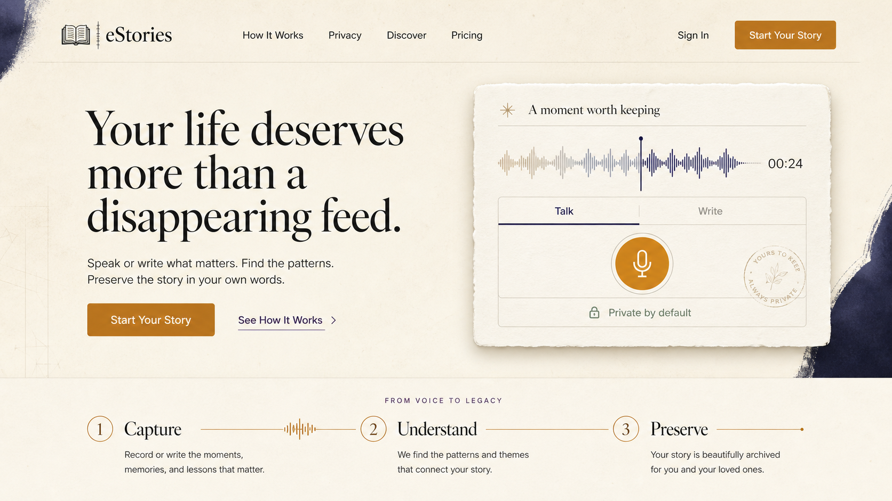

# eStories Living Archive UI/UX Implementation Guide

> **Status:** Approved visual direction; implementation not started  
> **Approved:** 2026-07-19  
> **Primary goal:** Deliver a major, cohesive aesthetic upgrade without changing existing product behavior  
> **Implementation order:** Web first, then Expo mobile alignment

## Approved Visual Reference



The reference above is the visual north star for the redesign. It establishes the intended warmth, editorial hierarchy, restraint, texture, color balance, and relationship between voice capture and preserved stories.

It is not a background image to place behind the website. Recreate the design with accessible HTML, CSS, React components, and lightweight decorative assets. Preserve the overall feeling and composition while ensuring the shipped interface is responsive, performant, and usable.

---

## 1. Direction and Boundaries

### Art Direction: Living Archive

eStories should feel like a private archive assembled with care: intimate, literary, durable, and distinctly human. The interface combines the calm authority of an editorial publication with subtle archival details and a modern voice-recording experience.

The memorable visual device is the **memory thread**: a thin line that can begin as a waveform, pass through written text, and resolve into a preserved story or collection. It should quietly connect major moments without becoming decorative noise.

### Experience Principles

1. **Stories lead; technology recedes.** AI, encryption, storage, and Web3 appear as supporting proof, not the dominant visual language.
2. **Typography carries the interface.** Prefer strong type hierarchy and whitespace over grids of icons and cards.
3. **Warmth over spectacle.** Use paper, ink, amber, and restrained indigo instead of neon, generic gradients, or constant glow.
4. **One focal moment per screen.** Each route gets one dominant visual or action; secondary controls remain quiet.
5. **Texture is atmospheric.** Grain, rules, stamps, and archival marks stay subtle and never reduce readability.
6. **Motion communicates transformation.** Animate voice becoming text, saving becoming preservation, and navigation state changes. Avoid ambient motion without meaning.
7. **Privacy feels reassuring.** Use plain language, sage accents, and calm lock indicators rather than warning-heavy security styling.

### Preserve These Behaviors

- Existing routes and deep links.
- Supabase authentication and the Firefox-safe same-origin refresh flow.
- Current story creation, transcription, enhancement, saving, draft recovery, visibility, collections, insights, social, vault, and Web3 behavior.
- Current server APIs, database schema, contracts, and storage strategy.
- Light and dark themes.

### Explicit Non-Goals

- No database migration or API redesign.
- No new features from `docs/CREATIVE_IDEAS_BACKLOG.md`.
- No auth state-machine refactor.
- No new wallet, minting, social, or AI capability.
- No use of the approved mockup as a flattened production UI.
- No visual rewrite of email templates during the web redesign.

---

## 2. Visual Foundation

### 2.1 Color System

Replace the competing shadcn defaults, raw grays, blue/purple gradients, and duplicated HSL/OKLCH values with one semantic source of truth. Map shadcn tokens to the Living Archive palette so feature components consume semantic names instead of raw colors.

#### Light Theme

| Token | Value | Use |
|---|---:|---|
| `--background` | `#F5F0E6` | Main parchment canvas |
| `--surface` / `--card` | `#FBF8F0` | Cards, dialogs, editor surfaces |
| `--surface-muted` | `#ECE4D7` | Secondary panels and selected rows |
| `--foreground` | `#181713` | Primary ink |
| `--foreground-muted` | `#5B574E` | Supporting copy and metadata |
| `--border` | `#D8CEBD` | Rules, dividers, control borders |
| `--brand-amber` | `#B7792A` | Primary actions and preservation moments |
| `--brand-amber-hover` | `#96601E` | Primary-action hover/pressed state |
| `--brand-indigo` | `#292650` | AI, waveform, and focused editorial accents |
| `--brand-plum` | `#6D5A73` | Reflective/insight accents |
| `--privacy-sage` | `#68735A` | Private/safe status |
| `--success` | `#4E6B50` | Confirmed success only |
| `--destructive` | `#A1443C` | Destructive actions and errors |

#### Dark Theme

| Token | Value | Use |
|---|---:|---|
| `--background` | `#14130F` | Main dark canvas |
| `--surface` / `--card` | `#1C1A16` | Elevated surfaces |
| `--surface-muted` | `#26221C` | Secondary panels |
| `--foreground` | `#F5F0E6` | Primary text |
| `--foreground-muted` | `#B8AE9E` | Supporting text |
| `--border` | `#3A352C` | Rules and borders |
| `--brand-amber` | `#D69A46` | Primary actions |
| `--brand-amber-hover` | `#E4AC5E` | Hover/pressed state |
| `--brand-indigo` | `#9992C9` | AI and focus accents |
| `--brand-plum` | `#AD93B4` | Insight accents |
| `--privacy-sage` | `#9EAD8B` | Private/safe status |
| `--success` | `#88A47F` | Confirmed success |
| `--destructive` | `#D7786D` | Errors and destructive actions |

Implementation requirements:

- Retain emotion and life-domain colors only where they encode actual metadata.
- Do not use emotion colors as general decoration.
- Use amber for one primary action per view.
- Use indigo for AI-assisted states, selection, or the memory thread—not generic button decoration.
- Validate all text/background combinations against WCAG AA. Adjust only the muted foreground values if necessary.
- Set `color-scheme` and `theme-color` correctly for both themes.

### 2.2 Typography

Use `next/font/google`; remove the global CSS font import and retire `Love Light` from the interface.

| Role | Family | Weight | Notes |
|---|---|---:|---|
| Display and editorial headings | Fraunces | 400–600 | Optical sizing enabled; restrained italics only for quotations |
| Body and interface | Source Sans 3 | 400–700 | Clear at small sizes; use tabular numerals for timers and metrics |
| Wordmark | Fraunces | 600 | No script font, stroke, or gradient fill |

#### Type Scale

| Style | Desktop | Mobile | Line height |
|---|---:|---:|---:|
| Hero display | 68px | 44px | 0.98 |
| Page title | 48px | 36px | 1.05 |
| Section title | 36px | 30px | 1.12 |
| Card/story title | 24px | 21px | 1.2 |
| Lead body | 20px | 18px | 1.55 |
| Body | 16px | 16px | 1.6 |
| UI label | 14px | 14px | 1.35 |
| Metadata | 13px | 13px | 1.4 |

Additional rules:

- Use `text-wrap: balance` for display headings and `text-wrap: pretty` for body introductions.
- Limit reading text to approximately 68 characters per line.
- Avoid all-caps except short archival eyebrows; apply generous tracking to those labels.
- Use numerals for counts and tabular numerals for timers, streaks, and metrics.

### 2.3 Spacing, Grid, and Shape

- Base spacing unit: 4px.
- Standard spacing steps: 4, 8, 12, 16, 24, 32, 48, 64, 96, and 128px.
- Desktop content maximum: 1280px.
- Reading column maximum: 720px.
- Marketing section vertical spacing: 112–144px desktop, 72–88px mobile.
- Product page spacing: 32–48px desktop, 24–32px mobile.
- Default control height: 44px; prominent CTA: 52px.
- Default corner radius: 8px; large panels: 14px; dialogs: 16px.
- Avoid oversized pill containers. Pills are reserved for compact status, tags, and segmented controls.
- Use asymmetry on marketing pages and disciplined grids on product pages.

### 2.4 Surfaces and Texture

- Default cards use a hairline border and extremely soft shadow; no glow.
- The hero capture artifact may use a subtle deckled-paper edge or mask. Do not repeat this treatment on every card.
- Create paper grain with a tiny reusable texture or CSS background layer at 2–4% opacity.
- Archival stamps are optional, decorative, and `aria-hidden`.
- Glassmorphism is not part of the new system.
- Avoid backdrop blur except where required for an overlay or sticky mobile chrome.

Recommended elevation tokens:

```css
--shadow-sm: 0 1px 2px rgb(24 23 19 / 0.05);
--shadow-md: 0 10px 30px rgb(45 37 24 / 0.08);
--shadow-lg: 0 24px 64px rgb(45 37 24 / 0.12);
```

Dark-mode shadows should become shallower and rely more on border contrast.

### 2.5 Icons and Brand Mark

- Continue using Lucide for interface icons at a consistent stroke weight.
- Use icons only when they improve scanning or clarify an action.
- Pair icon-only buttons with visible tooltips and `aria-label`.
- Redraw the existing book mark as a simple book-plus-thread SVG suitable for one-color use.
- Keep the wordmark flat ink in light mode and parchment in dark mode.
- Do not use gradient-filled text or `WebkitTextStroke`.

### 2.6 Motion

Use Framer Motion only for orchestrated entrances and state transitions; prefer CSS for hover/focus feedback.

| Token | Duration | Use |
|---|---:|---|
| Fast | 140ms | Hover and pressed state |
| Standard | 220ms | Tabs, menus, small state changes |
| Deliberate | 420ms | Page/section reveal, save confirmation |
| Narrative | 700–900ms | Voice-to-text memory-thread sequence only |

Motion rules:

- Animate only `opacity` and `transform` unless a component requires measured layout animation.
- Never use `transition: all`.
- Use a maximum movement distance of 12px for UI entrances.
- Keep hover scaling under 1.015; prefer color, underline, and elevation changes.
- The microphone may use one restrained pulse while recording.
- The memory thread draws once as a section enters the viewport; it does not loop.
- Honor `prefers-reduced-motion` by removing transforms and presenting the final state immediately.

### 2.7 Atmospheric Background

- Remove the global Three.js background from authoring, archive, onboarding, settings, and legal routes.
- Allow a lightweight version only on the anonymous homepage and selected reflection/insight moments.
- Replace floating orbs with a static parchment field, faint indigo edge washes, and sparse archival geometry.
- Lazy-load any retained 3D scene and provide a CSS-only fallback.
- Never allow atmospheric effects to sit directly behind reading text without an opaque-enough surface.

---

## 3. Shared Application Shell

### Anonymous Desktop Header

- Height: 76px; parchment background with one hairline divider.
- Left: book-thread mark and `eStories` wordmark.
- Center: `How It Works`, `Privacy`, `Discover`, `Pricing`.
- Right: `Sign In` and amber `Start Your Story` CTA.
- Sticky only after the user scrolls past the hero lead-in; use a solid surface rather than glass.

### Authenticated Desktop Header

- Left: wordmark linking Home.
- Center: `Archive`, `Discover`, and `Insights`.
- Right: amber `Create Story`, notifications, and profile menu.
- Do not show `Home` as a text item when the wordmark already provides that action.
- Move theme choice, wallet status, account actions, and settings into the profile menu.

### Mobile Navigation

- Use a bottom navigation bar with Home, Archive, Create, Discover, and Profile.
- Make Create the central raised action without using a large floating orb.
- Add `padding-bottom: env(safe-area-inset-bottom)`.
- Active state uses ink/amber and a short rule; inactive states remain quiet.
- Keep the top mobile bar to wordmark, context title when needed, and one contextual action.
- Do not render six destinations in a wrapped top navigation row.

### Route-Aware Chrome

- Hide global navigation and footer on onboarding.
- Use reduced chrome in Story Studio so the editor remains dominant.
- Legal and public story pages keep a minimal reading header.
- Ensure every layout exposes a keyboard skip link to `<main>`.

---

## 4. Screen Specifications

### 4.1 Anonymous Homepage `/`

#### Hero

- Recreate the approved two-column composition.
- Left eyebrow is optional; do not add trust-badge clutter above the headline.
- Approved headline: **“Your life deserves more than a disappearing feed.”**
- Supporting copy: **“Speak or write what matters. Find the patterns. Preserve the story in your own words.”**
- Primary CTA: `Start Your Story`.
- Secondary action: `See How It Works`.
- Right side uses a functional-looking Talk/Write capture artifact with waveform, `00:24`, microphone, and `Private by default`.
- On mobile, stack copy above the capture artifact; keep the CTA visible without covering the artifact.

#### Remaining Homepage Order

1. `From Voice to Legacy`: Capture, Understand, Preserve, connected by the memory thread.
2. Product demonstration showing a spoken fragment becoming a story and then a private archive entry.
3. Privacy section with simple ownership language and one supporting technical disclosure.
4. A small editorial selection of public stories using existing data; no generic testimonial carousel.
5. Final CTA on a deep-indigo editorial panel.
6. Restrained footer with product, legal, and social links.

Avoid the current long sequence of similarly weighted feature cards, statistics, and repeated CTAs. Every section must introduce one new idea.

### 4.2 Authenticated Home `/`

- Replace the marketing experience with a personal, editorial dashboard.
- Primary region: `Continue Draft` when a draft exists; otherwise `Create a Story`.
- Secondary region: recent stories as a clean list or staggered editorial grid.
- Include one compact weekly reflection/insight module using existing data.
- Keep activity metrics quiet and avoid turning the page into a chart dashboard.
- Use personalized greetings sparingly; the story content should dominate.

### 4.3 Story Studio `/record`

- Remove the standard wide page shell and use a focused canvas.
- Desktop composition: editor in a 720px central column plus a 280–320px metadata rail.
- Mobile composition: editor first; metadata and privacy open in bottom sheets.

#### Top Bar

- Back action, `New Story` or parent-story context, autosave status, and final Save action.
- Autosave states: `Saving draft…`, `Draft saved`, `Offline—saved on this device`, and `Save failed`.
- Use `aria-live="polite"` for status changes.

#### Capture Modes

- Use a clear `Talk | Write` segmented control.
- Talk mode: one large microphone control, waveform, timer, stop action, and transcription state.
- Write mode: title and generous text editor without competing cards.
- After transcription, move naturally into the same editor rather than presenting a separate result panel.

#### AI and Metadata

- Place Enhance, Listen, language, date, story type, and parent-story options in a quiet toolbar or metadata rail.
- Indigo indicates AI assistance; it must never imply the story was generated by AI.
- When enhanced, show `View changes`, `Keep original`, and `Use revision` with the original always recoverable.
- Put privacy near Save using plain language: `Private—only you can see this` or `Public—anyone can read this`.
- Keep vault and provenance details behind a `How this is protected` disclosure.

#### Failure States

- Microphone denied: show browser-specific recovery instructions and keep Write available.
- Transcription failed: keep the recording, offer Retry, and permit manual writing.
- Authentication expired: preserve the draft, request sign-in, then resume.
- Save failed: keep all content and show Retry; never clear the draft.

### 4.4 Archive `/library`

- Page title and story count use editorial type; primary action remains `Create Story`.
- Search is prominent and always labelled.
- Use `Stories | Collections` segmentation.
- Put type, privacy, and sort controls in a compact filter row; active filters become removable chips.
- Store search, segment, filters, and sort in query parameters so reload and browser navigation preserve state.
- Default story presentation is an editorial list on desktop and stacked cards on mobile.
- Each story exposes title, excerpt, date, type, privacy, canonical state, and a contextual action menu.
- Use amber only for canonical/preserved emphasis; use sage for private status.
- Empty states must distinguish no stories, no search results, and no items matching filters.
- Do not implement the backlog timeline view as part of this redesign.

### 4.5 Story Detail `/story/[storyId]`

- Use a centered reading column with generous top space and no dashboard card shell.
- Header order: story type eyebrow, title, author/date/privacy metadata, then optional audio.
- Body uses the reading typography system and supports long paragraphs, headings, quotations, and links.
- Place canonical/provenance proof in a calm expandable section after the story, not above the opening paragraph.
- Keep reactions, sharing, continuation, and collection actions visually secondary to reading.
- Add a sticky reading-progress line only if it remains subtle and is disabled for reduced motion.

### 4.6 Discover `/social`

- Display label becomes `Discover`; retain the existing route.
- Use an editorial feed with one featured story followed by a restrained grid/list.
- Search and existing filters remain clear, URL-backed where practical, and visually subordinate to content.
- Story cards emphasize the opening line and author rather than badges and metrics.
- Empty and signed-out states should invite reading before demanding account creation.

### 4.7 Insights `/tracker` and Story Insights

- Display label becomes `Insights`; retain `/tracker` for compatibility.
- Use the deep-indigo and muted-plum palette sparingly against parchment surfaces.
- Present themes, domains, and emotional patterns as reflection, not performance scoring.
- Explain every metric in one sentence and provide a clear empty state explaining that insights emerge after more stories.
- Keep charts simple, label values directly, and never rely on color alone.
- Allow sensitive insight sections to be collapsed without hiding the rest of the page.

### 4.8 Profile and Settings

- Use a literary profile header with avatar, name, short biography, and only the most meaningful counts.
- Separate `Stories`, `Collections`, and `Activity` cleanly.
- Move wallet connection, vault settings, theme, and account controls into a structured Settings region.
- Keep Web3 language explicit but optional; do not let it dominate public identity.

### 4.9 Onboarding and Authentication

- Match the Living Archive palette and typography; remove the generic gradient/glass card appearance.
- Keep fields in a single calm paper panel with direct labels and inline errors.
- Retain the current flow and validation behavior unless a separate product-flow change is approved.
- Explain vault and wallet steps in human language, with `Skip for now` visually available.
- Authentication modals must preserve the same-origin refresh and current provider behavior.

### 4.10 Supporting Screens

- Pricing: editorial comparison with one recommended plan, minimal badges, and clear recurring-price language.
- Notifications: use a readable activity list with clear read/unread treatment; avoid excessive colored icons.
- Waitlist/unsubscribe: use the same compact editorial form pattern.
- Privacy/terms: use the reading layout, table of contents, anchored headings, and a minimal header.
- Loading/error: use the book-thread mark or memory thread; never block interaction with decorative animation longer than necessary.

---

## 5. Component System

Update shared components before route-level redesigns so screens cannot drift.

### Required Variants

#### Button

- `primary`: amber fill, parchment/white text, one per view.
- `secondary`: ink or indigo outline.
- `quiet`: text action with underline/rule movement.
- `ghost`: low-emphasis toolbar action.
- `destructive`: reserved red treatment.
- Icon-only buttons require tooltip, `aria-label`, visible focus, and at least 44px hit area.

#### Card/Surface

- `paper`: standard content surface.
- `editorial`: typography-led, minimal border.
- `canonical`: restrained amber rule or corner mark; no continuous glow.
- `insight`: indigo rule/tint for AI reflection.
- `interactive`: adds hover elevation and focus-within state.

#### Form Controls

- 44px minimum height, 8px radius, visible labels, ink caret, and strong focus ring.
- Inputs include meaningful `name`, `type`, `autocomplete`, and `inputmode`.
- Errors sit beside the relevant field and explain the corrective action.
- Placeholders are examples, end with an ellipsis, and never substitute for labels.

#### Status and Badge

- `private`: sage lock and text.
- `public`: neutral globe and text.
- `canonical`: amber archive mark.
- `ai-assisted`: indigo sparkle/line, never a rainbow gradient.
- `success`, `warning`, and `error`: semantic colors with text/icon support.

#### Story Card

One shared structure with density variants:

- `featured` for the Discover lead.
- `standard` for Archive grids/lists.
- `compact` for recent stories and collection contents.

All variants must handle missing excerpt, missing audio, long titles, private/public state, and canonical state without changing height unpredictably.

#### Feedback States

Create reusable patterns for:

- skeleton loading;
- empty state;
- recoverable inline error;
- full-page error;
- draft/save status;
- offline status;
- success confirmation.

Toasts supplement visible state; they must not be the only place critical information appears.

---

## 6. Responsive Rules

### Mobile: below 640px

- Single-column content.
- 20px horizontal page padding.
- Bottom navigation with safe-area support.
- Hero display limited to approximately 44px.
- Full-width primary CTA where appropriate.
- Metadata and filters use sheets instead of narrow sidebars.
- Avoid auto-focus that opens the keyboard on page load.

### Tablet: 640–1023px

- Use 32px page padding.
- Stack hero content unless at least 800px of usable width remains.
- Story Studio stays centered; metadata moves below or into a sheet.
- Archive may use a two-column card grid only when content remains readable.

### Desktop: 1024px and above

- Use the 1280px max-width shell.
- Preserve asymmetrical marketing compositions.
- Story Studio may use the editor-plus-metadata-rail layout.
- Reading content stays capped at 720px even on ultrawide screens.

### Content Stress Cases

Every component must be checked with:

- a 1-character title;
- a 140-character title;
- a missing excerpt;
- a multi-paragraph excerpt;
- large browser text and 200% zoom;
- empty arrays and partially missing metadata;
- English text expansion of approximately 30% for future localization.

---

## 7. Accessibility Requirements

- Include a skip link and one `<main>` landmark per route.
- Maintain a logical heading hierarchy.
- Use `<button>` for actions and Next `<Link>` for navigation.
- Provide visible `:focus-visible` treatment on all interactive elements.
- Do not remove outlines without an equivalent focus indicator.
- Provide `aria-label` for theme, notification, microphone, playback, menu, and icon-only controls.
- Add `aria-expanded` and `aria-controls` to disclosures and accordions.
- Announce recording, transcription, enhancement, draft, save, and validation updates through polite live regions.
- Make all controls keyboard-operable and ensure dialogs trap and restore focus.
- Preserve browser zoom and support 200% zoom without horizontal scrolling.
- Ensure target sizes are at least 44×44px on touch screens.
- Never use color as the only indicator for privacy, error, insight category, or active navigation.
- Respect reduced motion, high contrast, and dark mode.
- Give images explicit dimensions and appropriate alternative text.
- Apply `overscroll-behavior: contain` to dialogs, drawers, and sheets.

---

## 8. Implementation Sequence

Each phase ends with visual review against the approved reference before the next begins.

### Phase 0: Baseline and Protection

1. Capture desktop and mobile screenshots of the current Home, Record, Archive, story detail, Discover, Insights, Profile, onboarding, and auth modal in both themes.
2. Record existing route behavior and critical interaction paths.
3. Confirm the working tree and avoid unrelated config/auth changes.
4. Add visual-review screenshots to a temporary local test artifact location, not the public bundle.

**Gate:** Baseline exists and functional invariants are documented.

### Phase 1: Foundations and Application Shell

1. Consolidate tokens in the global design-system CSS and map shadcn semantic variables.
2. Move Fraunces and Source Sans 3 to `next/font`; remove Love Light and the CSS font import.
3. Update shared Button, Card, Input, Textarea, Badge, Dialog, Dropdown, Tabs, Skeleton, and loader variants.
4. Build the book-thread mark and memory-thread decorative primitive.
5. Implement anonymous, authenticated, reduced, and mobile navigation shells.
6. Route atmospheric backgrounds so product screens no longer render global 3D.

**Gate:** Component gallery or representative test page is visually approved in light/dark and mobile/desktop states.

### Phase 2: Approved Homepage

1. Rebuild the anonymous homepage to match the approved concept.
2. Implement the capture artifact with CSS/SVG and production typography.
3. Recompose the remaining sections in the approved order.
4. Implement the authenticated Home variant.
5. Verify critical image/font loading and reduced-motion behavior.

**Gate:** Side-by-side visual review confirms the approved Living Archive character without using the mockup as a background.

### Phase 3: Story Studio

1. Recompose the existing Record UI without changing its data and save logic.
2. Implement Talk/Write visual modes, waveform/timer states, unified editor, metadata rail/sheets, and privacy summary.
3. Surface draft, offline, transcription, enhancement, and save states inline.
4. Verify every existing story type, visibility option, parent-story path, and vault/cloud save path.

**Gate:** Typed and recorded story paths complete successfully on desktop and mobile viewport tests.

### Phase 4: Archive and Reading

1. Redesign Archive search, segment, filters, story cards, collection cards, and empty states.
2. Sync retrieval state to URL parameters without changing backend queries unnecessarily.
3. Redesign story detail and collection reading views.
4. Validate long stories, missing metadata, private state, canonical state, and audio playback.

**Gate:** Archive retrieval and story reading are visually approved and regression-tested.

### Phase 5: Remaining Web Screens

1. Align Discover, Insights, Profile, Settings, notifications, pricing, onboarding, auth, waitlist, and legal screens.
2. Remove remaining raw gray values, generic gradients, glass classes, and unapproved glow patterns.
3. Confirm terminology is consistent: Archive, Discover, Insights, Create Story.
4. Complete responsive, keyboard, contrast, and content-stress passes.

**Gate:** No major route remains on the legacy visual system.

### Phase 6: Expo Mobile Alignment

1. Port semantic colors, typography roles, spacing, and component states into the mobile theme.
2. Update the tab bar to Home, Archive, Create, Discover, and Profile.
3. Recreate native equivalents of the Story Studio, Archive, and reading patterns.
4. Preserve Expo Router paths and native interaction expectations.
5. Validate safe areas, keyboard avoidance, screen-reader labels, and dark mode on iOS and Android.

**Gate:** Mobile feels native while clearly belonging to the same Living Archive system.

---

## 9. Verification Plan

### Functional Regression

- Anonymous and authenticated homepage states.
- Google and wallet authentication entry points.
- Onboarding completion and skip paths.
- Typed story creation.
- Audio recording, stop, transcription, enhancement, revert, playback, and save.
- Session draft recovery and failed-save retry.
- Private/public visibility and backdated story date.
- Archive search, filtering, sorting, collections, and story actions.
- Story reading, sharing, reactions, continuation, audio, and provenance.
- Theme switching, notifications, profile, wallet status, and vault settings.

### Visual and Responsive

Capture Playwright snapshots at minimum for:

- 390×844 mobile;
- 768×1024 tablet;
- 1440×900 desktop;
- 1920×1080 wide desktop.

Snapshot Home, Record, Archive, story detail, Discover, Profile, and onboarding in light and dark modes. Include empty, loading, error, and populated states where applicable.

### Accessibility

- Keyboard-only navigation and focus order.
- Screen-reader labels and live updates.
- 200% zoom and large text.
- Reduced motion.
- Contrast checks for text, controls, focus, and status states.
- Touch target and safe-area verification.

### Performance

- Confirm authoring and archive routes do not load Three.js bundles unnecessarily.
- Verify no layout shift from fonts, story images, or the hero artifact.
- Use transform/opacity-only motion where possible.
- Lazy-load below-fold media.
- Confirm the page remains usable before decorative assets load.

### Project Commands

Run focused component or route tests throughout a phase. At the end of each milestone—not after every small edit—run:

```bash
npx tsc --noEmit
npm run build
```

Run the relevant Vitest and Playwright suites before declaring a phase complete.

---

## 10. Visual Acceptance Checklist

A screen is ready for approval only when all answers are yes:

- Does it feel warm, literary, calm, and human?
- Is there one obvious visual focal point and one obvious primary action?
- Does typography create the hierarchy without relying on icon grids?
- Are amber, indigo, sage, and emotional colors used semantically?
- Are gradients, glass, glow, and background effects restrained or absent?
- Is the memory-thread motif purposeful rather than repeated decoration?
- Does the page still feel complete with motion disabled?
- Are light and dark themes equally intentional?
- Does mobile preserve hierarchy rather than merely stack desktop cards?
- Can long, empty, loading, error, private, and public states render cleanly?
- Are all interactions keyboard accessible with visible focus?
- Has the route retained its existing functional behavior?

---

## 11. Handoff Rules for Implementers

1. Treat the approved concept and this guide as the source of truth for the redesign.
2. Do not introduce a different art direction, generic SaaS components, or new feature scope without approval.
3. Read neighboring components and preserve existing behavior before changing layout.
4. Do not modify the protected authentication refresh patterns while styling auth UI.
5. Keep root configuration changes minimal; typography should not require a new npm dependency.
6. Make shared primitives first, then build pages from them.
7. Request visual approval at every phase gate.
8. Keep before/after screenshots for review.
9. Run milestone verification before handing work to another agent.
10. Update this document if an approved visual decision changes so later implementers do not have to guess.

---

## Final Definition of Done

The redesign is complete when every primary web route uses the Living Archive system; the approved homepage character is evident throughout the product; all existing critical flows still work; accessibility, responsive, dark-mode, and performance checks pass; milestone type-checks/builds pass; and no screen relies on the legacy gradient/glass/glow visual language except where explicitly documented.
