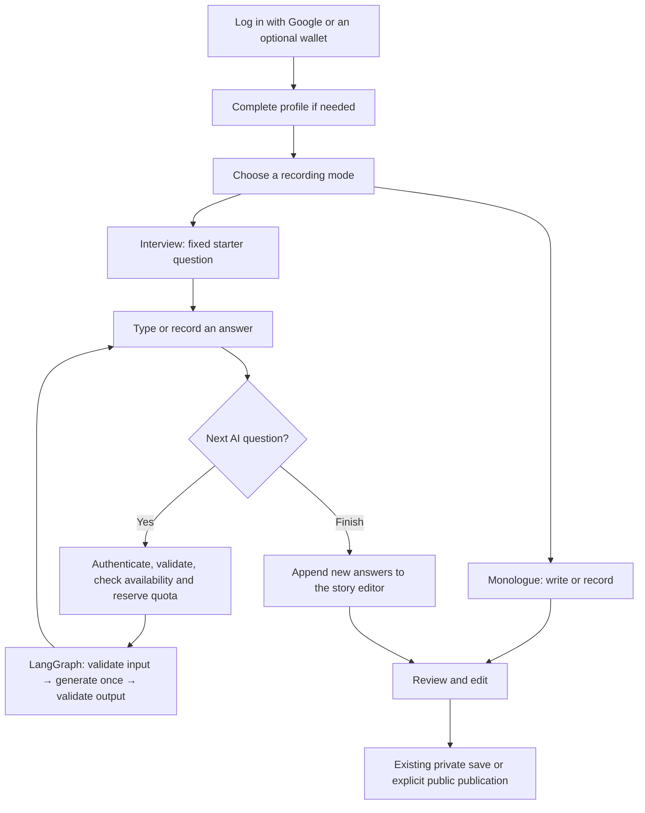

# Standard login and guided story interviews

Implementation batch: Living Archive web foundation, 2026-11-24. This document describes the candidate source, not a production deployment. Hosted staging remains deferred. Mobile authentication and recording screens are outside this batch.

## Experience

The header offers **Log in**. Google is the primary path; wallet login remains available as an alternative. Existing accounts, wallet signatures, OAuth callbacks and same-origin refresh are retained. No password database or new authentication provider is introduced.

New accounts complete one profile form, then open `/record`. Wallet and Local Vault setup are optional account features. The old onboarding sequence could redirect home immediately after saving a profile, skipping its subsequent steps; there is no longer a required wallet/vault tour to skip.

The recording page offers two modes:

- **Monologue:** record freely or type in the story editor.
- **Guided interview:** start with a clearly labelled, fixed starter question. Type or record an answer, then explicitly request the next AI question. Finish whenever you want by adding the answers to the story editor. Review and edit before saving or publishing.

Switching modes keeps both drafts. Interview answers are appended in question-and-answer form, without generating an invented first-person narrative. Repeated additions copy only answers not already added. Questions are not read aloud in this version.

## Availability, cost and privacy

The implementation does **not** enable production AI, change billing, provision providers or migrate the database. Existing AI setup holds and release fences still apply. If assistance is unavailable, typed answers remain usable and can be added to a story without inference. Recording depends on the existing transcription service.

`POST /api/ai/interview` uses authenticated canonical ownership, including an expected-owner header to reject stale account submissions. It accepts only a topic and completed turns; client-supplied user IDs, provider choices and instructions to tools are not authority.

Limits are deterministic:

| Control | Limit or behavior |
| --- | --- |
| Topic | 200 characters |
| Answers | Six total, including the starter answer |
| Each answer | 1,500 characters |
| Next-question context | At most five completed answers |
| Request body | 64 KiB, measured while streaming, independent of Content-Length |
| Generated question | One question, at most 240 characters; strict JSON schema; exact repeats rejected |
| Model output budget | 512 tokens for interview questions |
| Provider deadline | Existing 25-second bounded routing budget |
| Recording per interview answer | 90 seconds and 8 MiB |
| Admission | Existing enhancement/text-assistance pool; denial fails closed |
| Fallback | Existing configured DeepSeek routing; every additional provider call needs a separate durable quota reservation |
| Retries | Explicit user action; no automatic schema repair or agent loop |

The LangGraph task has no tools, checkpointer or durable conversation store. Private inference keeps ambient tracing disabled. The evaluation source fingerprint includes the interview route, contracts and graph task. Deterministic tests validate contracts, auth, account changes, quota, holds, retries, output rejection and UI behavior without paid inference or an LLM judge.

Next-question requests disclose the interview topic and prior answers to the configured AI provider. Recording discloses audio to the transcription provider. These disclosures appear beside the controls. Story text and provider errors are not logged by the new endpoint. Model questions render as ordinary React text, without HTML execution.

Interview and editor drafts are scoped to the account in sessionStorage. They are **not vault-encrypted**, are not a cloud backup, and can be lost when browser storage is cleared or the tab closes. An unavailable/full store shows a warning for interviews. Account changes remount the interview/editor, abort interview requests and stop its microphone. This is account separation in the UI, not protection against someone with access to the same browser's developer tools.

The previous unassigned `estories_record_draft` key is retained for manual recovery, without automatically importing another person's draft. No saved cloud stories are moved or deleted. Older unsaved drafts will not automatically appear in the new editor. Before clearing browser storage, recover any needed old draft locally; never paste private story contents into issue reports.

Questions are validated structurally, not proven semantically safe by a schema. Before enabling live journal inference, verify the provider's current privacy terms and models, evaluate synthetic interview quality and safety, and confirm quota behavior. Gemini 2.5 Flash currently supports disabling thinking for this small task; provider model lifecycle changes require revalidation rather than silently assuming the same configuration remains supported. See [Google's thinking controls](https://firebase.google.com/docs/ai-logic/thinking).

## Interface foundation

The homepage uses the Living Archive paper/ink palette, self-hosted Fraunces and Source Sans 3, and a lightweight illustrative story preview. It keeps the mobile waitlist. No real customer story is used in visual assets. Root layout no longer mounts the global decorative WebGL background. Existing background context consumers remain compatible.

Navigation separates public discovery from the signed-in workspace. Mobile uses a compact header and five workspace destinations; Tracker remains accessible through the account menu and homepage shortcut. Controls have accessible names, a skip link, larger targets and reduced-motion support. Footer links point to actual routes instead of generic social-service homepages or an unconditional operational claim. Onchain verification remains coming soon.

The cookie banner is in document flow, with equal optional/essential choices and a footer control to revisit them. The Meta base pixel and custom helpers require optional marketing consent; denial revokes the loaded pixel's consent. A storage failure defaults to denying marketing for the current page. Vercel operational analytics retain their existing behavior; this change is not a claim that every telemetry system is cookie-based or covered by Meta consent.

## Verification and rollout

Run the focused unit/API tests, the complete web/evaluation suites, lint, web/evaluation TypeScript checks and the isolated production build. Public Playwright journeys cover login entry, privacy/deletion, the anonymous recording boundary, the story preview and overflow at 320, 390, 768 and 1440 CSS pixels in Chromium and Firefox. Use computer use to inspect mobile/desktop, light/dark and keyboard/modal behavior on the candidate.

Live Google OAuth, a physical-device microphone, adaptive interview quality and provider fallback require controlled synthetic accounts/provider setup; mock tests do not establish those real integrations. No real journals, mainnet payments or paid inference are required for this batch's deterministic checks.

Before any production promotion, apply the installed web/mobile production audit to the exact commit, artifact, environment and release entry points, then verify delivery. Reverting the compatible application change is the rollback path; this feature has no database migration. Keep AI disabled until the separate inference setup gate is satisfied.

Remaining design-plan phases include archive/story layouts, profile/privacy settings, truthful pricing and payment states, and native-screen alignment. A 3D book viewer remains optional, subject to measured usefulness and performance. This first batch does not claim those later phases are complete.
