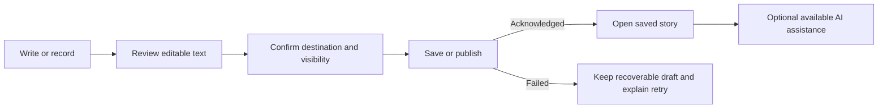

# eStories product and interface upgrade plan

Prepared 2026-11-24. Status: implementation started; see [the first batch guide](LOGIN_AND_GUIDED_INTERVIEW.md). Original plan, supported by a public browser review and source inspection. No application, provider, payment, database or deployment changes are part of preparing this document.

## 1. Recommendation

**Correction, 2026-11-25 — current direction:** User review rejected the replacement branding and reduced landing-page content. Preserve the established logo, gold/purple wordmark, blue/purple/amber palette, original hero and useful cards. Improve hierarchy, accessibility, responsive behavior and clear Log in / Sign up entry points within that design. Keep the Google onboarding and guided-interview functionality. Review the revised interface before production promotion. The replacement-branding recommendation below is superseded.

Build on **Living Archive**, the direction in the [existing implementation guide](../UI_UX_IMPLEMENTATION_GUIDE.md): a contemporary editorial product with warm surfaces, confident typography and a recognisable thread connecting voice, text and a saved story. Make creating and revisiting a story the centre of the interface.

The current product needs a consistent system and clearer task flows before it needs more visual effects. Replace the gradient script wordmark, competing blue/purple/amber accents, repetitive feature cards and ambient particles with deliberate composition and useful interaction. Preserve writing, recording, reading and payment behaviour while making their states easier to understand.

Use 3D selectively: a manipulable book preview can communicate a collection's physical form; a global field of floating orbs does little to help someone write. Ship the core redesign with static assets first. A 3D enhancement earns inclusion through usability and performance evidence.

### What success looks like

- A visitor understands what the app does and can find how to start without knowing Web3 terminology.
- A writer can distinguish an unsaved draft, a saved private cloud story, a Local Vault entry and a public publication.
- Every feature presents its actual availability. AI setup requirements and parked verification are understandable, without making the rest of the app look broken.
- Pages share recognisable typography, controls and spacing while using layouts suited to their content.
- The mobile interface works comfortably with a keyboard, long titles and text enlargement.
- The main flows remain usable with motion disabled, WebGL unavailable and slow connectivity.

## 2. Evidence and limits

### Reviewed material

| Evidence | Scope and binding |
| --- | --- |
| Live Firefox review | `https://estories.app/`, `/pricing` and the anonymous `/record` gate; 2026-11-24 |
| Live deployment readback | Health reported production commit `a2cb94cd51142df65e2879ba67c54fbfc00abfb6`, active |
| Desktop viewport | 1440 × 1000 CSS px; [captured homepage](images/review-2026-11-24/home-desktop.png) |
| Mobile-width viewport | 390 × 844 CSS px; [captured homepage](images/review-2026-11-24/home-mobile.png); browser resizing, not a physical-device test |
| Implementation source | Separate worktree at `f15f647111ed04337b35c24ae9666af4f485ec57`; source observations are not proof that this commit is deployed |
| Existing direction | [Living Archive guide](../UI_UX_IMPLEMENTATION_GUIDE.md), [concept image](images/living-archive-homepage-concept.png) and [existing design system](../DESIGN_SYSTEM.md) |

The primary local checkout remains older than the inspected implementation and contains existing user edits. Start implementation from current master in a clean worktree; do not build the redesign on the older checkout or discard those edits.

Authenticated capture, archive, insights, payment completion and native screens were not exercised in this review. Their recommendations below come from source and product analysis and require synthetic-account acceptance. Dark-mode public pages were visually inspected; complete light-mode acceptance remains to be done. No Lighthouse, field Core Web Vitals, GPU, native FPS or conversion baseline was measured. Targets in this plan are proposed budgets, not measured results.

### Findings to address

| Finding | Evidence | Product consequence | Priority |
| --- | --- | --- | --- |
| Horizontal overflow at mobile width | Homepage document width was 411px at a 390px viewport | Narrow screens can scroll sideways; the responsible element still needs isolating | P0 |
| Mobile navigation occupies two rows | Approximately 137px high; six destinations plus brand/account controls | Less room for the actual task | P0 |
| Navigation icon buttons lack names | Two visible icon-only nav buttons returned no `aria-label` or `title`; inspect their full accessible names during implementation | Controls may be unclear to assistive technology | P0 |
| First-visit consent panel overlaps substantial content | Observed in both saved screenshots; especially dominant on mobile | Main actions and reading compete with a persistent overlay | P0 |
| Several visual systems compete | Gradient script logo, multicolour headline, glass navigation, dark navy cards and animated background | Brand feels assembled rather than authored | P1 |
| Design tokens have competing definitions | `app/globals.css` includes OKLCH and HSL definitions; `styles/design-system.css` adds another vocabulary | Local fixes can produce inconsistent themes | P1 |
| Multiple font-loading approaches | Layout uses Inter/Love Light; CSS imports Fraunces remotely | Unclear hierarchy and avoidable font-loading work | P1 |
| Decorative WebGL is mounted from the root layout | `GlobalBackgroundDynamic`, `GlobalBackground`, particle/orb frame loops | Rendering and bundle work can affect unrelated product screens; actual cost needs profiling | P1 |
| Trust and feature copy need an availability review | Pricing presents AI benefits and future features; footer includes placeholder destinations and unconditional operational copy | Presentation can imply more availability or evidence than exists | P0/P1 |
| Useful state logic already exists | `StoryInsights` distinguishes disabled, queued, running, retry and failure states | Preserve this work; improve how it is presented instead of flattening it into a spinner | Retain |

Do not infer a tracking-compliance failure from the cookie component's comments or this visual review. Verify actual consent and tracking behaviour separately when updating that interface. An overflow observation likewise identifies a symptom, not its exact CSS cause.

## 3. Product direction and navigation

### Primary jobs

1. Capture a thought through writing or voice.
2. Save it with a clearly understood destination and visibility.
3. Find and reread it later.
4. Request available assistance without losing the original wording.
5. Optionally share a story or assemble a collection.

Private journals, creative writing and public storytelling can share these jobs. Keep the brand broad enough for all three; do not imply every story is a personal diary or a public social post.

### Separate public discovery from the writing workspace

| Context | Proposed navigation | Rules |
| --- | --- | --- |
| Anonymous desktop | Brand; How it works; Discover; Pricing; Sign in; Start a story | Use existing routes or real homepage anchors; notification controls belong to signed-in users |
| Anonymous mobile | Compact brand row, Start a story, labelled menu | Put secondary destinations in an accessible menu; no six-item application tab bar |
| Signed-in desktop | Home, Archive, Create, Discover; profile/account menu | Tracker remains visible from Home and the account menu; preserve `/tracker` and direct links |
| Signed-in mobile | Home, Archive, Create, Discover, You | Five clear destinations; Tracker reachable from Home and You; test discoverability before committing this hierarchy |
| Editor/reader | Quiet task header, back/breadcrumb, relevant action | Reduce marketing chrome without removing account or navigation access |

Keep all existing URLs and native deep links. Renaming a destination is a presentation change; changing an auth boundary, persistence model or route contract requires a separate feature decision. If testing shows Tracker becomes difficult to find, revisit the five-item arrangement rather than hide functionality to fit a layout.

Replace anonymous **Connect** with **Sign in**. Inside the existing authentication flow, distinguish Google sign-in from connecting a wallet. Preserve account-linking protections and the Firefox-safe refresh mechanism.

## 4. Visual system

### Art direction

Use the existing concept's editorial hierarchy, warm paper/ink relationship and restrained indigo thread. Translate these into real components rather than a screenshot used as a background. Retain a clean, modern reading surface: texture is optional and extremely subtle; avoid making every card look like torn paper.

The distinctive device is a **memory thread**: a fine rule that can become a short waveform, a reading-position marker or a collection spine. Use it in a few meaningful places, not as a repeating decoration on every card.

Example public hero copy for design exploration:

> Keep the stories that matter.
>
> Write or record a story. Revisit it in your archive, in your own words.

Primary action: **Start a story**. Secondary action: **See an example**. Any example is explicitly labelled synthetic and runs without recording, uploading or calling a model. AI and verification claims are conditional on actual capability; they are not required in the hero promise.

### Composition

```text
Desktop public homepage
┌──────────────────────────────────────────────────────────┐
│ Brand       How it works   Discover   Pricing     Sign in │
├───────────────────────────────┬──────────────────────────┤
│ Clear editorial headline      │ A sample story artifact  │
│ Short explanation             │ Voice / text example     │
│ Start a story   See an example │ Explicitly a demo        │
├───────────────────────────────┴──────────────────────────┤
│ Capture → Save → Revisit, shown through the product       │
│ Privacy/storage explanation · Available capabilities      │
│ Pricing link · Useful FAQ · Real footer destinations     │
└──────────────────────────────────────────────────────────┘

Mobile: headline → explanation → primary action → example.
Keep the action before decorative artwork in reading order.
```

Use asymmetry on the homepage, a restrained workspace on Home/Archive and a narrow editorial column for reading. Reserve cards for bounded objects or grouped decisions; plain lists, rules and whitespace work better for many settings and story lists.

### Tokens and type

Create one semantic source in `styles/design-system.css`, with compatible mappings for Tailwind/shadcn and the mobile theme. Use `surface`, `text`, `text-muted`, `action`, `focus`, `border`, `success`, `warning` and `danger` roles. Remove superseded definitions in a controlled migration. Existing `hsl(var(...))` usages need correctly formatted transitional aliases; pointing them at raw hex values would break CSS.

| Role | Light proposal | Dark proposal |
| --- | --- | --- |
| Background | `#F5F0E6` | `#14130F` |
| Main surface | `#FBF8F0` | `#1C1A16` |
| Main text | `#181713` | `#F5F0E6` |
| Muted text | `#5B574E` | `#B8AE9E` |
| Primary action background | `#8A541C` | `#D69A46` |
| Primary action text | `#FFFFFF` | `#181713` |
| Secondary brand accent | Restrained indigo | Lighter indigo |

Computed opaque sRGB pairs: light primary action 6.24:1; dark primary action 7.32:1; light muted text on background 6.34:1. The earlier `#B7792A`/white pairing is 3.63:1, so it is unsuitable for ordinary-size button text. These calculations do not validate transparency, hover, disabled, focus or every component state; test those separately. Follow [WCAG contrast guidance](https://www.w3.org/WAI/WCAG22/Understanding/contrast-minimum.html).

- **Display:** Fraunces for headlines and occasional story titles.
- **Interface/body:** Source Sans 3 for controls, reading and forms. Keep long prose highly readable; evaluate the final editorial serif usage with real content.
- Use the existing font tooling to self-host the chosen files at runtime. Remove the extra CSS font request and script wordmark once the replacement is accepted.
- Limit weights/subsets to what is needed, retain language coverage and tune fallback metrics to limit layout shift.
- Use a responsive scale: hero approximately 40–64px; page headings 30–40px; reading text 17–19px; normal interface text 16px. Avoid tiny metadata as the primary information channel.
- Base spacing: 4px; use a small scale through 8/12/16/24/32/48/64/96. Reading measure roughly 60–72 characters; main content max 1200–1280px.
- Control targets at least 44px by design; use 48px where appropriate for native controls. Default radius 8–12px; larger radius only for major panels/dialogs.
- Use Lucide consistently, approximately 20px with a consistent stroke. Name every icon-only control. Colour alone never carries privacy, error or selection meaning.

The existing design-system document describes an earlier implementation vocabulary. This plan proposes its consolidation; implementation must update the system documentation when tokens actually change. Do not leave two competing normative design systems.

## 5. Page-by-page upgrade

| Page or family | Proposed experience | Required states / acceptance |
| --- | --- | --- |
| Public `/` | Editorial hero and one understandable product example; fewer repeated claims/cards | Start action visible early on mobile; demo is labelled; no invented testimonials, counts or trust seals |
| Signed-in `/` | Continue a draft, create a story, recent entries and a quiet Tracker link | New account, returning account, no draft, data error and AI unavailable remain distinct |
| `/record` | One studio with Write/Voice modes, visible destination, draft status and an obvious Save action | Permission denied, recording interruption, unsupported media, upload/transcription failure, AI disabled, save failure and session expiry preserve recoverable content |
| `/library` | Searchable archive with date/collection filters and list/grid choice only if useful | Empty archive, no search results, pagination/loading, error, locked vault, long titles; filter state survives navigation where supported |
| `/library/collections/[collectionId]` | Clear collection identity, ordered stories and restrained management controls | Empty collection, permission denial, missing entry, reorder failure; keyboard alternative to drag |
| `/story/[storyId]` | Reading-first layout with author/date/visibility metadata and a secondary insights panel | Owner/public viewer/unauthorized access; signed audio URL expiry; edit and AI suggestions do not overwrite the original silently |
| `/books/[bookId]` | Cover, description, chapter list and readable chapter navigation | Accessible 2D cover is complete by itself; optional 3D preview never gates reading or implies minting occurred |
| `/social` | Editorial Discover feed with useful filters and clear author identity | Synthetic preview fixtures; real public content only when permitted; no private snippets in feed, skeleton or share image |
| `/tracker` and insight components | Explain observations in plain language, connect them to supporting entries and include sample/date context | Insufficient data, stale results, provider unavailable, pending/retry/failed; no fabricated precision or diagnostic health claims |
| `/profile` | Stories, account details and settings have clear hierarchy | Separate private account controls from public identity; destructive actions have explicit consequences |
| `/profile/[username]` | Public author page focused on published work | Public-only counts/content, missing author, long biography, no private/vault exposure |
| Auth and onboarding | Clear sign-in choices, short explanation of storage and a purposeful first step | Cancelled sign-in, expired link/session, wallet rejection and account-link conflict; preserve return destination |
| `/pricing` | Scannable comparison of currently available benefits, limits and payment expectations | Current plan, pending verification, unsuccessful/expired payment, duplicate submission; unavailable AI and coming-soon features are not sold as active benefits |
| `/notifications` | Read/unread list with meaningful destinations and grouped dates | Empty list, loading, failure and deleted target; all controls named |
| Privacy/terms/community guidelines/account deletion | Calm, readable documents and clear account actions | Text zoom, heading structure, keyboard access; deletion and publication remain distinct operations |
| Waitlist/unsubscribe/error/not-found/loading | Same typography and controls with concise task-specific feedback | Clear next action, recovery and real progress; remove decorative delays that conceal readiness |

### Capture and save state contract

Show **Draft on this device**, **Saving…**, **Saved privately**, **Saved in Local Vault**, and **Published publicly** only when those statements are supported by the existing implementation. A local browser draft is not a server save or an encrypted vault entry. Do not promise draft durability beyond what the browser and current account-scoping behaviour provide.

Design the following sequence before polishing animations:



This diagram describes user-facing checkpoints, not a replacement for the existing server workflow. AI status is separate from save status. A saved story can have queued, failed or unavailable analysis. Display the existing state faithfully; do not introduce a fake progress percentage or silently enable live inference.

Private cloud, Local Vault and public publishing require different explanations. Never reuse the concept image's decorative “always private” stamp as a blanket security promise. Public/IPFS publication requires a deliberate existing confirmation; changing defaults or the publishing contract is outside a visual-only change.

## 6. Interaction and motion

| Interaction | Behaviour | Fallback |
| --- | --- | --- |
| Buttons/tabs | Immediate visual response, visible focus, clear selected state | Fully understandable without animation |
| Voice capture | Actual recording state, duration and bounded waveform sampling | Numeric timer and text status; no decorative pulse presented as recording |
| Save feedback | Inline state near the action; persistent failure message with retry | Toast is supplementary, never the only evidence of save/failure |
| Archive filtering | Clear result count, empty-result explanation, retained input focus | Standard labelled controls; no animated masonry reshuffle required |
| Insights | Progressive disclosure of detail, evidence/context where available | Plain text hierarchy; no spinning “intelligence” animation |
| Collection reorder | Clear handle plus move-up/down controls and undo/error feedback | Full keyboard operation |
| Consent | Concise explanation, similarly prominent choices and accessible preference access | Never infer acceptance from dismissal; preserve existing preferences |

Use approximately 120–180ms for small feedback and 180–240ms for panels. Animate transform/opacity when possible; avoid animating layout, shadows or large blur layers continuously. No scroll hijacking, custom cursor, mandatory parallax, hover-only actions or repeated staggered entrances.

Respect reduced motion for CSS, Framer Motion, recording visuals and WebGL together. On mobile, test reduced motion, keyboard opening, safe areas and screen-reader focus. Any optional haptic has a useful action behind it and respects platform settings.

## 7. 3D and asset plan

### Where depth is useful

| Candidate | Recommended implementation | Inclusion decision |
| --- | --- | --- |
| Public hero artifact | Accessible HTML/CSS story sheet; small SVG thread/waveform | Ship first; optional shallow perspective from pointer input only after testing |
| Book/collection preview | Static cover plus optional, explicitly activated rotatable book | Best first true-3D experiment; use “View in 3D” and a labelled reset control |
| Voice → saved-story demonstration | Short bounded SVG/CSS transformation using synthetic content | Prefer this to a permanently running WebGL scene |
| Pattern exploration | Accessible 2D chart/list with text explanations | Keep 2D; a 3D graph adds navigation burden and can imply relationships the data does not support |
| Global particles/orbs | Retire from the shared application shell after equivalent fallback acceptance | No replacement ambient canvas in editor, archive, pricing or settings |

### Asset deliverables

1. Flat one-colour book/thread brand mark with clear small-size treatment.
2. A small SVG memory-thread/waveform set, with no text baked into imagery.
3. A synthetic story-sheet illustration, built from the same tokens as the real UI.
4. Book-cover layouts and a responsive AVIF/WebP poster for the optional 3D book.
5. If justified, one reusable GLB book mesh with simple materials and bounded textures.

Record creator/source, licence, export settings, dimensions, compressed transfer size and fallback in an asset manifest during implementation. Prefer original or properly licensed assets. No new paid asset subscription is needed for the first milestones. Journal text, private covers and account data must not be sent to asset-generation tools or third-party texture services.

### Rendering requirements

- No Three.js/R3F/Drei download in initial marketing or core-task requests solely for decoration. Gate the optional import before the heavy module loads; hiding a mounted canvas is insufficient.
- Render the poster first with stable dimensions. WebGL support, reduced motion and an explicit activation decision are checked before fetching the enhancement. Honour Save-Data when available; do not treat user-agent strings as a reliable performance test.
- One optional canvas in the visible feature. Render on demand, invalidate for interaction and let it settle. Mutate animation refs rather than updating React state for every pointer sample. [R3F documents on-demand rendering, invalidation and resource reuse](https://r3f.docs.pmnd.rs/advanced/scaling-performance).
- Stop rendering while hidden or offscreen. Handle context loss and initialisation failure by showing the same poster and controls without a broken page.
- Reuse geometry/materials, dispose owned resources and remove listeners on unmount. Avoid runtime environment maps, bloom, physics, live reflections and continuous expensive shadows for this use case.
- Keep semantics and actions in HTML/native controls. Canvas output is decorative or supplementary, with an equivalent 2D representation. Never require dragging to access a story.
- Native phase one uses the poster and normal native interactions. Reusing the web canvas inside a WebView would add complexity without proving native value.

### Provisional 3D budgets

| Budget | Initial target |
| --- | --- |
| Optional model geometry | ≤20,000 visible triangles and ≤25 draw calls |
| Model transfer | ≤250 KiB compressed GLB |
| Texture transfer | ≤256 KiB total; longest edge at most 1024px initially |
| Whole first activation | ≤900 KiB compressed transferred JS, decoders, geometry and textures combined |
| Poster | ≤100 KiB mobile / ≤150 KiB desktop |
| Pixel ratio | Cap at 1.25 initially; increase only after device measurements |
| Idle scene | No self-scheduled animation frames after settling |
| Interaction | Aim for p95 frame time ≤16.7ms on the agreed reference desktop; degrade to poster if the agreed lower-capability device cannot sustain the experience |

These are project proposals, not universal engine limits. Measure the complete feature, including any decoder/runtime additions. If a visually useful result cannot meet the budget, ship the poster; 3D is not a release dependency.

## 8. Performance and accessibility acceptance

### Measurement contract

Use a production build with synthetic fixtures. Record full SHA, route, browser version, device, viewport, network/CPU settings, cache state and whether optional assets were activated. Compare equivalent cold runs; start with three runs per representative route and keep their raw results. Lighthouse is a lab diagnostic, not proof of real-user INP or native performance.

For real traffic, target mobile and desktop p75 **LCP ≤2.5s, INP ≤200ms and CLS ≤0.1**, in line with [Core Web Vitals guidance](https://web.dev/articles/vitals). With low traffic, report insufficient field samples and use repeatable lab checks rather than inventing a field percentile.

| Area | Proposed release budget / check |
| --- | --- |
| Initial JS | No optional 3D; target ≤220 KiB compressed marketing JS and ≤350 KiB for a core task before optional wallet/3D activation. Baseline first; if already above target, require a reduction plan and no increase attributable to the redesign |
| Fonts | Target ≤180 KiB combined first-use font transfer; avoid duplicate loaders and unnecessary weights |
| Main visual | Prefer responsive static art; reserve dimensions; do not make the LCP wait for a canvas or autoplay video |
| Interaction | No redesign-caused typing/scrolling jank; target visible typing feedback within 100ms in the agreed lab scenario; verify the entire save response separately |
| Long lists | Paginate first; introduce virtualization only where profiling demonstrates a need, with focus and scroll restoration preserved |
| Data requests | No new layout-triggered refetch loops; reuse current query keys and cancellation. Never add a global cache for private story data |
| Regression | Record compressed bytes before/after; block unexplained regressions. A larger budget requires an explicit measured tradeoff, not a silently revised threshold |

Keep server-renderable public content outside unnecessary client/provider gates where feasible. Profile provider waterfalls before changing boundaries. Do not refactor auth, move queries or add blanket memoization simply to make a performance checklist look complete.

### Accessibility checklist

Use [WCAG 2.2 AA](https://www.w3.org/TR/WCAG22/) as the implementation target. Test keyboard operation, meaningful control names, visible unobscured focus, text/non-text contrast, reflow at 320 CSS px, 200% text resizing, text spacing and non-drag alternatives. The project's 44px target preference is deliberately stronger than WCAG's 24px minimum in applicable cases.

- Verify at 320, 390, 768, 1024 and 1440px with no unintended horizontal scrolling.
- Ensure sticky headers, consent controls and the native keyboard do not hide the focused control or the active save action.
- Dialogs have focus containment, a meaningful heading, Escape/dismiss behaviour where appropriate and focus restoration.
- Provide text alternatives for meaningful art, captions/transcripts where applicable and non-animated recording feedback.
- Check screen-reader output for auth, draft/save state, validation errors and queued AI work. Avoid repeatedly announcing polling updates.
- Test light/dark/reduced-motion/high-contrast configurations and long names, titles and unbroken text.

Run automated accessibility checks, then manually verify the relevant journeys. A clean automated scan is not an accessibility certification.

## 9. Implementation architecture and protection

### Reuse and consolidate

| Area | Likely implementation locations | Boundary |
| --- | --- | --- |
| Tokens and font loading | `styles/design-system.css`, `app/globals.css`, `app/layout.tsx` | One canonical vocabulary; compatible migration of existing classes |
| Navigation and page shell | `components/Navigation.tsx`, `components/Footer.tsx`, layout wrappers | Preserve links, auth semantics and content reading order |
| Core primitives | Existing `components/ui/*` | Reuse Radix/shadcn behaviour; define supported variants and remove route-specific overrides gradually |
| Story presentation | `components/StoryCard.tsx`, `components/StoryInsights.tsx`, `components/WeeklyReflection.tsx` | Existing response shapes, owner checks and AI statuses remain intact |
| Capture/archive/detail | Existing route client components | Small route-focused changes, preserving drafts and save contracts |
| Optional scene | `components/three/*` and a feature-specific loader | Remove global mounting; avoid a second rendering framework |
| Native theme/screens | `mobile/` theme, UI components and Expo Router screens | Shared design values, native layout/interaction; no web-DOM assumptions |

Define component variants for primary/secondary/destructive/loading buttons; story list item; editor toolbar; field/help/error; visibility label; inline service status; empty/error/loading states; menu/dialog; audio transport; filter bar; pricing comparison. Treat these as a small product vocabulary rather than a large speculative component library.

Visual work must not change: same-origin auth refresh, owner authorization, account linking, private audio access, publication confirmation, payment verification/idempotency, draft cleanup rules or provider activation. Keep CRE labelled coming soon and separate from AI output quality. If a needed capability signal does not exist in the current contract, record that gap as a separately scoped change instead of inventing a client flag that enables service access.

Use synthetic stories and accounts in previews. Never connect a preview that can mutate state to production merely to make an acceptance test easier. Hosted staging remains deferred: local isolated fixtures, CI and protected previews are sufficient to begin this design work. Where a preview has no isolated backend, restrict it to fixtures/read-only public journeys and keep backend acceptance in the isolated test environment.

## 10. Delivery sequence

Estimates below are planning ranges for one implementer with periodic design review, not promises. Discovery and existing code constraints may change them. The founder can be the product reviewer; this plan does not introduce a requirement to find a second collaborator.

| Checkpoint | Work and deliverables | Exit criteria | Approximate effort |
| --- | --- | --- | --- |
| 0 — Baseline | Align clean source worktree; capture major routes/states; identify overflow; gather bundle/lab baseline; map enabled capabilities | Versioned evidence, interaction/state inventory and agreed tokens; no app changes needed to finish discovery | 1–2 working days |
| 1 — Foundation and shell | Colour/type consolidation, readable brand mark, named controls, responsive navigation, consent layout and real footer destinations | Public + signed-in shell checks; no new overflow; themes/focus work; capability copy reviewed. First small production candidate | 2–4 days |
| 2 — Create and revisit | Studio, save-state presentation, archive and story reader; explicit privacy destinations | Synthetic create → save → reload → read passes, plus denied permission/save failure/AI-off cases | 3–5 days |
| 3 — Remaining web | Collections/books, Discover, Tracker, profiles, pricing, notifications, auth/support pages | All routes have real empty/loading/error/permission states; publication/payment regressions pass | 3–5 days |
| 4 — Native alignment | Tokens, five-destination proposal, capture/archive/reader, keyboard and accessibility | Signed Android/iOS device evidence for the accepted scope before any native release; web changes do not imply mobile readiness | 3–5 days |
| 5 — Optional depth | Small book-preview prototype, poster/fallback, asset manifest and measured comparison | Demonstrates usefulness; meets complete activation budget; otherwise defer | 1–3 days, optional |

Do not hold checkpoint 1 or 2 until every page or optional asset is finished. Use short-lived feature branches and normal checks. Scope a temporary migration wrapper/legacy token adapter only if needed to keep intermediate screens coherent; remove it once its consumers migrate rather than maintain parallel themes indefinitely.

### First implementation batch

1. Reproduce and identify the 390px overflow; add a focused regression for the actual cause.
2. Establish semantic tokens and accessible action colours; verify representative existing components before applying them widely.
3. Replace the wordmark treatment and unify font loading.
4. Separate anonymous and signed-in navigation, including accessible names and mobile focus/keyboard behaviour.
5. Redesign the consent layout while preserving preferences and independently verifying actual tracking behaviour.
6. Replace placeholder footer destinations and unsupported operational claims with real links or omission.
7. Pilot the new homepage with accessible static art. Remove decorative WebGL from core routes only after fallback, theme and bundle checks.
8. Present desktop/mobile/light/dark evidence, the measured delta and unresolved issues for the first release review.

## 11. Test-driven and evaluation-driven workflow

For an interaction change, write the behavioural expectation first, use a representative fixture and verify it against the current behaviour. Use component tests for state and keyboard logic, route/API tests for authorization/persistence contracts, and browser tests for real focus, scrolling and layout. Do not create tests that simply repeat class names.

### Required representative scenarios

- Anonymous user understands the page, can open sign-in and can navigate back without losing the intended route.
- OAuth-only and wallet-linked synthetic users can use the same core writing flow.
- A private story is saved, reloaded and remains absent from public views; an unavailable AI service does not prevent supported manual writing/saving.
- A failed save keeps recoverable input and does not display success. Session expiry does not silently publish or discard it.
- Recording denied/interrupted, AI queued/retried/disabled and signed audio URL expiry produce distinct actionable states.
- Payment pending/failed/already-applied states retain the existing verification rules; clicking twice does not create a visual promise of duplicate entitlement.
- A 200-item fixture tests archive controls and scrolling without fetching real customer content.
- Reduced motion, unsupported WebGL, context loss and asset failure keep the complete 2D experience.

Keep existing deterministic AI evaluations as a regression guard when touching their UI consumers. Model calls and LLM judges are unnecessary for visual comparison, accessibility, layout, privacy assertions or functional UI correctness. Live semantic-quality testing remains a separate, budgeted evaluation concern; see the [evaluation documentation](../AI_AGENT_EVALUATION_IMPLEMENTATION_GUIDE.md).

For visual regressions, use stable fixtures, fonts, dates, viewport and theme; freeze intentional motion. Review screenshot differences rather than automatically accepting a new baseline. Run the milestone type/build/unit/browser checks through the current CI configuration; do not use a green run from a different commit as evidence.

### Human design review

Score clarity, hierarchy, consistency, task feedback and brand distinctiveness from 1–5 using the actual screens. Aim for at least 4 in each before broad rollout, with no unresolved privacy misunderstanding, inaccessible control or blocked core action. This is a review rubric, not an automated claim that the design is objectively correct.

Run an initial formative study with roughly five people using synthetic stories. Ask them to find how to start, save a private entry, recover a failed save and find the entry again. Aim for at least four to finish each task without intervention. Any misunderstanding that could expose private content requires correction even if the aggregate score is high. This small sample is directional feedback, not statistically significant conversion evidence.

## 12. Cost, measurement and release

Use existing libraries and assets first. Do not add a second motion engine, a new state library, paid design tooling or a hosted 3D service simply to execute this plan. New dependencies need a concrete measured benefit and compatibility check.

Track task completion, failure recovery, first saved story and return-to-archive behaviour only through approved, privacy-conscious measurement. Do not log story text, prompts, transcript snippets, private titles, search strings or signed media URLs into analytics or screenshots. With no repeat-user baseline, combine usability findings with aggregate operational evidence; do not run an underpowered A/B test or invent improvement percentages.

For each production candidate: bind the exact commit and compiled artifact, run the existing production/security audit, verify compatibility and critical journeys, then verify actual delivery after deployment. A design approval or passing screenshot comparison does not replace that gate. Retain a compatible prior application artifact and a clear hold/recovery action; a visual change alone does not require a database migration or fresh production export.

This plan does not merge PRs, change Vercel promotion settings, enable providers, publish mobile builds or make purchases. Mobile is unreleased and gets separate artifact/device acceptance. Hosted staging and optional 3D are not prerequisites to shipping the first well-tested web improvements.

## 13. Definition of done

- All scoped pages use the agreed design vocabulary and show truthful feature/service states.
- The first save and return-to-read flows are understandable and have tested failure recovery.
- Existing auth, privacy, publishing, payment and AI contracts pass their relevant regressions.
- Mobile-width overflow is fixed at its cause; keyboard, text resizing and reduced motion work.
- Light/dark screenshots, accessibility findings and performance comparisons are bound to the candidate.
- Optional 3D stays within budget and is removable without loss of function; a static-only release is acceptable.
- Tokens, component usage, asset provenance and remaining gaps are documented. Historical docs are labelled and the obsolete design vocabulary is retired as implementation progresses.
- The scoped release receives its own production decision and post-delivery verification; no blanket promise of zero future defects is made.

## Reference links

- [Existing Living Archive implementation guide](../UI_UX_IMPLEMENTATION_GUIDE.md).
- [Existing design system reference](../DESIGN_SYSTEM.md).
- [AI evaluation documentation](../AI_AGENT_EVALUATION_IMPLEMENTATION_GUIDE.md).
- [AI runtime and operations](../AI_RUNTIME_AND_OPERATIONS.md).
- [WCAG 2.2 standard](https://www.w3.org/TR/WCAG22/) and [contrast guidance](https://www.w3.org/WAI/WCAG22/Understanding/contrast-minimum.html).
- [Core Web Vitals definitions and measurement](https://web.dev/articles/vitals).
- [React Three Fiber performance guidance](https://r3f.docs.pmnd.rs/advanced/scaling-performance).

External technical references checked 2026-11-24. Recheck library-specific APIs against the repository's pinned versions during implementation. This document proposes no dependency upgrades by itself.
